# trading-research-pipeline

A pre-registered strategy-search pipeline for crypto markets: data → regimes → instruments →
signal → search → execution (taker | passive | maker) → verdict → study → agent → paper. A
candidate is registered with the condition that would kill it before any held-out day is read,
a held-out block is read once through a ledger, and every result is net of a stated fee.

```bash
trp demo --execution all --verify   # the whole path on a generated market, then the checks
trp verify all                      # each component against data with a planted answer
trp agent demo                      # the research loop through the agent harness, synthetic
```

| Study, held-out block read once | Fee a side, bp | Held-out result, net of the fee | Status |
|---|---|---|---|
| Cross-sectional reversion, 26 USDT perpetuals, 26 Feb–11 Mar 2024 | taker 5.5 + 0.5 slippage | +6.99 bp a trade (median); by day +6.18 bp, t 1.18, 14 days; −19.94 bp the next six weeks | conditional |
| Market making round 1, Bybit BICOUSDT, 26 Feb–9 Mar 2024 | maker 2.0, taker 5.5 | touch quoter −5.00 bp of turnover; 4 of 4 hypotheses killed | killed |
| Market making round 2, six Bybit altcoins, 26 Feb–9 Mar 2024 | maker 2.0, taker 5.5 | −0.067 USDT per 100 USDT of clip a day; 5 of 5 killed | killed |
| Maker, Bybit BTCUSDT perpetual, 8 Apr–30 Jun 2021 | maker −2.5, taker 7.5 | −2.69 bp per fill, 0 of 84 days positive | killed¹ |
| Spot taker, Binance BTC/FDUSD and Bybit BTCUSDT, 8 Aug–21 Oct 2026 | 0/10 and 10/10 | −17.35, −19.43, −19.28 bp a trade | killed |
| Spot maker, Binance BTC/FDUSD, 8 Aug–21 Oct 2026 | maker 0, taker 10 | −2.35, −2.88, −2.79 bp per fill | killed¹ |
| Short-horizon search, Bybit BTCUSDT perpetual, 2025 | maker 2.0, taker 5.5 | held-out blocks not read | development complete |

¹ uncalibrated fill rule. Two exploratory replications of the author's 2025 research are negative
after any fee; every study is in [Registered studies](#registered-studies).

---

## Contents

[Walk the pipeline](#walk-the-pipeline) ·
[Add a strategy](#add-a-strategy) ·
[Check it is not a fiction](#check-it-is-not-a-fiction) ·
[Registered studies](#registered-studies) ·
[Deploy: paper trading](#deploy-paper-trading) ·
[Agents](#agents) ·
[The findings](#the-findings) ·
[Methodology](#methodology) ·
[Data](#data) ·
[Limitations](#limitations) ·
[Disclaimer](#disclaimer) ·
[License](#license)

Install: Python 3.11+ and [uv](https://docs.astral.sh/uv/).

```bash
git clone https://github.com/bamasa/trading-research-pipeline
cd trading-research-pipeline
uv sync --all-extras
uv run trp --help          # the map: one group per step, in the order the pipeline runs
uv run pytest -m "not slow"  # synthetic data and fixtures, no network
```

`trp` and `trading-research` are the same program; every command also keeps its
flat name (`trp download` is `trp data download`). Nothing under `data/`,
`artifacts/` or `runs/` is committed. The commands below are written without
`uv run`.

---

## Walk the pipeline

Ten steps, each a command group. Every step reads files and writes files, so a
step can be inspected, re-run or replaced without re-running what came before.
`trp demo` runs steps 1 to 7 on a generated market in a few minutes and writes
one page per execution mode; the subsections say what each step does on real
data.

### 1 Data

```bash
trp data download --symbol BTCUSDT --kind bookTicker --start 2024-02-01 --end 2024-03-09 --grid 100ms
trp data download-book --symbol BICOUSDT --start 2024-02-01 --end 2024-02-25
trp data generate-demo-data --output data/demo
trp data validate-data --input data/demo
trp data describe-schema book
```

- **Reads**: Binance's and Bybit's public archives (checksums verified), or
  nothing for the synthetic market.
- **Writes**: `data/raw`, `data/book`, `data/demo`, each a directory under a
  declared contract ([`docs/data_contract.md`](docs/data_contract.md)) with a
  `manifest.json` of where it came from.
- **Refuses**: nothing by itself; a gap, a crossed book or a clock problem is a
  finding of `validate-data`, not a crash. A registered study fetches its
  protected days only through its own entry point and ledger (step 8).

### 2 Regimes

```bash
trp regimes breaks --symbol BTCUSDT --interval 1d --start 2024-01-01 --end 2026-09-30 --plot
```

- **Reads**: daily or hourly bars (`--prices` for a file already on disk).
- **Writes**: `artifacts/breaks`: each break, its family (scale, dependence,
  mean) and the odds behind it.
- **Detectors**: a CUSUM changepoint detector over book blocks
  ([`validation/changepoint.py`](src/trading_research/validation/changepoint.py))
  and a whitened Shiryaev-Roberts monitor on returns
  ([`validation/structural_breaks.py`](src/trading_research/validation/structural_breaks.py),
  from [adia-structural-break](https://github.com/bamasa/adia-structural-break),
  installed with `uv sync --extra breaks`). Thresholds are calibrated on a
  null. On 1,003 BTCUSDT daily returns from January 2024 the monitor flags one
  break, 13 September 2025, scale, downward; forty shuffled copies of the same
  returns flag one copy.

<picture>
  <source media="(prefers-color-scheme: dark)" srcset="docs/images/structural_breaks_BTCUSDT_dark.png">
  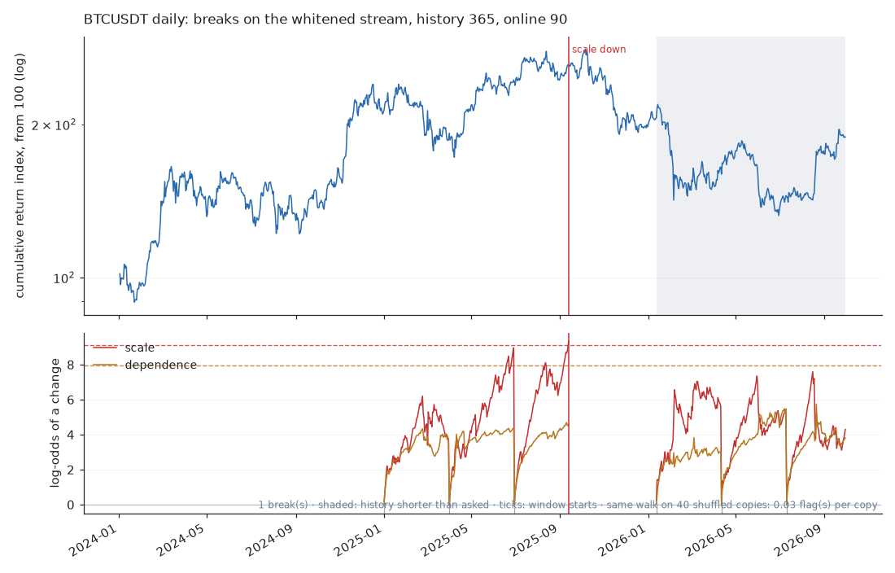
</picture>

### 3 Instruments

```bash
trp instruments discover
trp instruments screen --raw data/raw --horizon-s 120
```

- **Reads**: the venue's listing (`discover`) and the days of each instrument
  already under `data/raw` (`screen`; three are enough).
- **Writes**: `artifacts/screen`: each instrument ranked by edge over cost, both
  halves of it (how far the price moves against the cost, and whether the book
  predicts where).
- **What it found**: the best of forty-four instruments has an average edge
  about a tenth of its cost, and BTCUSDT a thirtieth; re-run seven weeks apart
  on eighty instruments, the rank correlation is 0.59, so a basket of five to
  ten is chosen rather than one best name.

### 4 Signal

```bash
trp signal prepare --symbol BTCUSDT --horizon 1200 --subsample 50
trp signal select --train-start 2024-02-01 --train-end 2024-02-14
trp signal train --train-start 2024-02-01 --train-end 2024-02-14 --model logistic
trp signal predict --start 2024-02-22 --end 2024-02-28
```

- **Reads**: `data/raw`; each later command reads the previous one's files
  under `artifacts/` (`prepared`, `features`, `model`).
- **Writes**: `artifacts/prepared` (one file per day), `artifacts/features`
  (the list chosen on the training window), `artifacts/model`,
  `artifacts/predictions`.
- **Refuses**: a feature that does not declare its look-back; the test suite
  changes the data after a cutoff and fails if any value before it moved.
  `select` and `train` read only the window they are given; the embargo is
  derived from the label's horizon.

### 5 Search

```bash
trp search register --data data/walkthrough --run artifacts/search
trp search instruments --run artifacts/search
trp search frequency --run artifacts/search
trp search method --run artifacts/search
trp search model --run artifacts/search
trp search execution --run artifacts/search
trp search read --run artifacts/search
trp search status --run artifacts/search
```

- **Reads**: a dataset root (`raw/`, and `book/`, `trades/`, `funding/` for a
  maker); each step reads the previous step's `chosen.json`.
- **Writes**: one folder per step under `--run`, the registration first (from
  the file names, before any day is read) and a ledger.
- **Refuses**: every step before `read` sees the search block only; the hold
  and label threshold are chosen by their neighbourhood, with the peak reported
  beside the choice; `read` opens the held-out block once and a second `read`
  is refused by the ledger. `trp search run` runs the steps in order.

### 6 Execution: taker, passive or maker

```bash
trp backtest --min-confidence 0.62 --hold 24 --cooldown 120
trp backtest exit-search --model logistic --hold 24
trp backtest retrain-search --model logistic --start 2024-02-15 --train-days 3,7,14,21 --apply-days 1,3,7
trp backtest mm-backtest --symbol BICOUSDT --start 2024-02-01 --end 2024-02-25 --strategy s1 --frozen
```

- **Reads**: `artifacts/predictions` (taker), the market-making study's book,
  prints and funding (`mm-backtest`).
- **Writes**: `artifacts/backtest`, `artifacts/exits`, `artifacts/retrain`,
  `artifacts/mm`: every attempt, misses included, with the fee, spread and
  slippage it paid.
- **Modes**: a taker crosses the spread on both legs; a passive entry rests at
  the touch and fills only through the queue; the market maker quotes both
  sides in event time and fills only from prints
  ([`docs/market_making_simulator.md`](docs/market_making_simulator.md)). Every
  mode returns the same table for the same statistic to judge.
- **Refuses**: `mm-backtest` refuses a held-out or boundary day unless
  `--allow-heldout` is given, then reads it only with the frozen values and
  through the ledger; a second read also needs `--second-read` and is stamped
  as one. Fees come from one place: `trp fees` lists every table the costs are
  read from, with its source.

### 7 Verdict

```bash
trp review --trades trades.csv --days 14
```

- **Reads**: a CSV of trades with a `net_bp` column (the backtest writes
  `artifacts/backtest/trades.parquet`).
- **Writes**: `artifacts/review`: result, dispersion, drawdown, and how many
  trades the edge would need to be established, for a reviewer
  ([`docs/evaluation/rubric.md`](docs/evaluation/rubric.md)). It grades nothing.
- **In a study** the verdict is the entry point's: the day-clustered t, the
  kill conditions written before the read, placebos, Holm across slots, and a
  fee ladder in which every tier but the verdict tier is a labelled
  measurement.

### 8 Study

```bash
trp study list
trp study stages spot_2026
trp study status spot_2026
trp study run spot_2026 --dry-run
trp study pages spot_2026
```

- **Reads**: the study's registration (`docs/preregistration/<study>.md`), its
  YAML (`configs/<study>.yaml`) and its ledger
  (`experiments/results/<study>_ledger.json`).
- **Writes**: through the study's own entry point
  (`experiments/<study>.py`, run unmodified in a fresh interpreter), its stage
  records and pages under `experiments/results/`.
- **Refuses**: a stage out of order; `open` and `read` of a held-out block
  without the frozen configuration committed and the tree clean; a block whose
  read has finished (its results' sha256 is in the ledger).

### 9 Agent

```bash
trp agent calendar
trp agent demo
trp agent run --help
```

The research loop (propose, register, run, review, record) run by a model under
a policy; see [Agents](#agents).

### 10 Paper

```bash
trp paper replay --day data/demo --model artifacts/model --execution taker --fee-tier base --fee-asof 2026-09-15
```

The model on a public stream or a replayed day, with no order path; see
[Deploy: paper trading](#deploy-paper-trading).

---

## Add a strategy

A strategy, model, feature set, label or execution is one file, found by a
registry ([`docs/extending.md`](docs/extending.md)).

```bash
trp strategies new my_rule                     # writes strategies/contrib/my_rule.py and its test
trp strategies list --kind strategy
trp strategies check my_rule                   # protocol, no look-ahead, executions, synthetic
trp strategies backtest my_rule --execution taker,passive
trp study new my_study --template taker        # a registration skeleton naming it
```

1. **Fork** the repository and work on a branch of your fork.
2. **`trp strategies new`** writes a working plugin from the template under the
   kind's `contrib/` folder, and a test for it. A strategy declares `lookback`
   (rows it reads before the decision), `horizon` (rows it holds) and `inputs`
   (the columns it reads), and implements `fit(history)` and `decide(frame)`,
   returning −1, 0 or +1 per row.
3. **`trp strategies check`** runs the conformance suite and writes a page
   under `artifacts/plugins/`:
   (a) the protocol; (b) no look-ahead, by changing every input after a row and
   requiring the decisions up to it unchanged, and the declared look-back;
   (c) every execution plugin with a fee-table row; (d) the synthetic checks:
   on book days with a planted queue-imbalance edge, whether the strategy finds
   it, whether its trades earned more than the planted drift owed them (only a
   strategy reading the future can), nothing on the null, and the edge lost
   when its decisions are moved to other days. A failure names the check.
4. **`trp strategies backtest`** fits it on the front of the synthetic demo
   market (or `--input` a dataset) and trades the rest in each execution mode
   at the fee tier named.
5. **Into a study**: `trp study new` writes a registration document, its YAML
   with `null` placeholders and an entry point that refuses to run until both
   are filled. The registration names the plugin, its parameters and its file's
   sha256; the hypothesis, the kill conditions and the held-out block are
   committed before any of its data is read.

---

## Check it is not a fiction

Every component that decides a result is run on generated data whose answer is
known, and on the same data with nothing planted
([`docs/synthetic.md`](docs/synthetic.md)).

```bash
trp synthetic book-days --feature imbalance --size-bp 16
trp synthetic cross-section
trp verify edge
trp verify all
trp verify all --quick
```

The generators: book days with an edge planted on queue imbalance or on flow,
break days with one regime break at a known time, a cross-section with a
planted reversion or momentum, order-level order flow with a planted adverse
selection and the queue's truth, a funding series with a planted persistence;
each with a seed, a `truth.json` and a null. `trp verify all` (about two and a
half minutes) writes a page per check under `artifacts/verify/` and exits 1 if
any binding criterion fails; `--quick` runs fewer days and paths, at sizes
whose verdicts matched the default run's.

Result of `trp verify all` (default sizes, seed 20200106):

| Check | Component | Result | Why |
|---|---|---|---|
| edge | `order_flow` rule, `logistic`, `lightgbm` on imbalance; `logistic`, `lightgbm` on flow | pass | find the planted 16 bp, owe it 80–93% per trade, recovered equals planted, nothing on the null, placebos kill it |
| edge | `spread_capture` rule | **fail** | a look-ahead: its tight-spread test is a quantile of the whole frame it is handed, so a decision reads later rows |
| edge | the flow-share rule (`order_flow:flow_imbalance_24`) | **fail** | a share of signed volume cannot tell an episode's burst of prints from two prints on one side; its trades sit on episodes 5% of the time |
| detector | `changepoint.detect` | **fail** | finds the break, but 0.72 false alarms a day against a bound of 0.5: its spread statistic reads the spread in bp of a moving mid |
| detector | `structural_breaks.detect_breaks` | pass | finds every planted break within an hour, no false alarm |
| simulator | the market-making simulator | pass | markouts recover the planted adverse selection; fills match an order-level replay within 2 points; the cancellation brackets contain the truth |
| reversion | the relative and index reversion rules | pass | find the planted reversion, lose on planted momentum, nothing on the null |

`trp strategies check --all` adds two failures of the plugin suite: the
`random_forest` and `extra_trees` models are not reproducible to the bit when
refitted (threaded trees, changes of 2e-16), which the fold-level leakage test
reads as a moved fit; and the generated feature set's exponentially weighted
means remember every earlier row, so no finite declared look-back is true
(nothing reads forward). These are
findings about existing components, reported and not changed: the registered
studies depend on them as they are.

---

## Registered studies

Each study has a registration committed before its held-out data was fetched
([`docs/preregistration/`](docs/preregistration/)), a YAML with every value that
decides a status, an entry point, and a ledger that lets each held-out block be
read once. The verdict is net of the fee named; a zero-fee number appears only
beside it, as a reference.

| Study | Venue, instrument | Held-out period | Fee a side, bp (verdict tier) | Slots | Held-out result, net of the fee | Status |
|---|---|---|---|---|---|---|
| Cross-sectional reversion ([§27](docs/results.md#27-cross-sectional-reversion-and-the-market-state-it-requires)) | 26 USDT perpetuals | 26 Feb–11 Mar 2024 | taker 5.5 + 0.5 slippage, plus the spread (12–16 a round trip) | one rule, three parameters | +6.99 bp a trade, median over 22 of 26 positive; by day +6.18 bp, t 1.18 over 14 days, 8 positive; 12 Mar–20 Apr: −19.94 bp, 0 of 26 | conditional on the index's 10-minute autocorrelation (−0.10 where it pays, 0.00 where it does not) |
| Market making, round 1 ([registration](docs/preregistration/market_making.md)) | Bybit BICOUSDT perpetual | 26 Feb–9 Mar 2024 | maker 2.0, taker 5.5 | H1, H2.1, H2.2, H3 | touch quoter −5.00 bp of turnover; the comparison quoter S1 −7.50; every strategy negative under every cancellation rule and latency | all four killed |
| Market making, round 2 ([registration](docs/preregistration/market_making_round2.md)) | Bybit ALICE, ALGO, JTO, ZEC, GALA, CAKE perpetuals | 26 Feb–9 Mar 2024 | maker 2.0, taker 5.5 | B1, B2, B3a, B3b, B4 | B1 −0.067 USDT per 100 USDT of clip a day; the positive nets at the 0 bp and −1 bp maker tiers are inventory (K-dir) | all five killed |
| Maker at the 2021 fees | Bybit BTCUSDT perpetual | 8 Apr–30 Jun 2021 | maker −2.5, taker 7.5 | S0, F | S0 −2.69 bp per fill (−227.27 USDT per 100 USDT of clip a day), 0 of 84 days positive; F not admitted on D (−2.64) | killed; uncalibrated fill rule |
| Short-horizon search, 2025 | Bybit BTCUSDT perpetual | H 8 Jul–20 Aug 2025, then F and P | maker 2.0, taker 5.5 | S25, S-C, S-R, S-P, S-M, S25-Z | development complete; the held-out blocks are not read, so no number is a result | waiting for H |
| Spot taker, 2026 | Binance BTC/FDUSD; Bybit BTCUSDT spot | 8 Aug–21 Oct 2026 | Binance Regular 0 / 10; Bybit non-VIP 10 / 10 | S25-PF, S25-BB, S25-T | S25-PF −17.35, S25-BB −19.43, S25-T −19.28 bp a trade | all killed by K1; P not read |
| Spot maker, 2026 | Binance BTC/FDUSD | 8 Aug–21 Oct 2026 | maker 0, taker flatten 10 | MK-S, MK-Q, MK-SQ | MK-S −2.35, MK-Q −2.88, MK-SQ −2.79 bp per fill | all killed by K1; uncalibrated fill rule |

Two replications of the author's 2025 research are exploratory, not registered,
and read days that research had seen:

| Replication | Venue, days | Fee | Result | Reading |
|---|---|---|---|---|
| BTC/FDUSD, one recipe at two fees | Binance BTC/FDUSD spot prints; 2025-02-04..26 and 2025-06-08..30, 46 test days | Regular 0 / 10 bp | −20.19 bp a trade, 0% of days positive (zero-fee reference −0.19) | positive at neither fee; a profit of that kind on the pair needed the zero fee |
| ETH, a TCN and its gate, frozen | Bybit ETHUSDT perpetual; tested frozen on 2026-08-08..21 | taker 2.2 and 5.5 bp | gross edge 0.31 bp of turnover; loses on each of the 14 days at both fees | negative after any fee |

To run a study's steps: `trp study list`, then `trp study stages <study>` and
`trp study run <study> <stage>`; a block's `open` and `read` are the owner's
call, and on this repository the read blocks refuse to be read again. The
market-making rounds run through their experiment scripts
(`python -m experiments.market_making`, `python -m experiments.market_making_heldout`,
`python -m experiments.market_making_verdicts`); the reversion end to end is
`trp reproduce`, which fetches what is missing and reads its held-out block
once.

---

## Deploy: paper trading

```bash
trp paper record --venue bybit --market spot --symbol BTCUSDT --minutes 60
trp paper replay --day 2026-10-27 --venue bybit --market spot --symbol BTCUSDT --model artifacts/model --execution passive
trp paper run --venue binance --market spot --symbol BTCUSDT --model artifacts/model --execution taker --minutes 120
trp paper status runs/paper/X
trp paper parity --day data/demo --output parity.csv
```

The backtest's features, model, execution rules and fee table, run on a public
market-data stream (`run`, `record`) or a stored day (`replay`, `parity`)
([`docs/paper_trading.md`](docs/paper_trading.md)).

- **Public data only, no order path.** The only URLs are Bybit's and Binance's
  public market-data streams, checked against a fixed list before a run starts;
  there is no key, no signature and no private endpoint, and a run refuses to
  start if its configuration names anything shaped like a credential.
- **Fills** are the backtests' model: a taker gets the next print of its side,
  a resting order fills when a print trades through it, at the fee the dated
  table (`trp fees`) gives for that instant.
- **Parity.** On a replayed day the streaming features equal the batch features
  at every boundary within relative 1e-7: 27 of 34 registry and timed features
  and 106 of 211 prepared columns bit for bit; seven rolling-dispersion columns
  differ by rounding and are listed as such. A live session replayed from its
  own recording gives identical probabilities.
- **Kill switch.** Latched by a loss at or beyond `--max-loss`, a position past
  the limit, a stale book, or a sequence gap or reconnect: nothing new is sent,
  resting orders are cancelled and the position is closed by a taker order.
- **Pages.** Each run writes `runs/paper/<run>/page.md` with its money,
  decisions, fills, latency and gaps, and a manifest with the model's sha256
  and the fee sources.

A paper result is a measurement under those fill rules, never evidence that a
strategy would have made money. The agent harness never runs `paper run` or
`paper record`: inside a registered prospective block, live data is that
block's held-out data.

---

## Agents

[`CLAUDE.md`](CLAUDE.md) holds the rules any agent follows here, and
[`agents/`](agents/README.md) a harness that runs a model through the loop the
registered studies followed by hand: propose, register, run, review, verdict,
record ([`agents/protocol.md`](agents/protocol.md),
[`docs/agents.md`](docs/agents.md)).

```bash
trp agent demo              # the whole loop on a synthetic study, a scripted client in place of a model
trp agent calendar          # every range a registration protects
trp agent status            # the runs, their steps, handbacks and stops
```

- **Roles**: researcher, registrar, executor, skeptic, scribe, each with its
  own prompt and its own commands.
- **Policy**: every tool call is decided before it runs: the repository's own
  commands one at a time, read-only git, no push, no remote, no edit of study
  code, no write under `data/`, no fetch that touches a day any registration on
  any local branch protects, `open` and `read` only on the owner's grant, no
  `paper run` or `paper record` for any role, `paper replay` only on days
  outside every protected range.
- **Verdict**: the study code's, checked against its ledger; the loop stops at
  every gate the owner holds.
- **Logged**: every decision with its reason, each tool output's sha256 and
  size, each turn's token usage and the calendar it enforced, every path
  relative; the run directory is scanned for the shapes of a secret after every
  turn, and a finding stops the loop.

`trp demo --agent` adds the loop to the demo page. A model is used only when a
key, a model name and the SDK are present; otherwise the scripted client runs.

---

## The findings

One positive result with its domain of validity stated, and a broad negative
that motivated looking for it. In that order, because the second is what makes
the first worth having.

---

## The finding: reversion, and the state it needs

An equal-weighted index of twenty-six USDT perpetuals is computed, excluding the
instrument being traded. When the index has moved far over the last ten minutes,
take the opposite side in that instrument and close ten minutes later. No model,
three parameters.

### Where it pays

On a held-out fortnight — parameters chosen on the 26 days before it, the block
read once:

| | |
|---|---|
| Instruments positive | **22 of 26** |
| Median net per trade | **+6.99 bp** |
| Gross per trade | +20.50 bp |
| Cost per trade | 12–16 bp |

A model on top, predicting *how far each trade will run* and leaving the exit to
the rule, raises the pooled figure to **+18.8 bp per trade over 3,297 trades**,
paired *t* of 10.0, with two independent boosters agreeing to within 1.6 bp.
Asking the model *when to exit* instead fails on every architecture tried — that
distinction is the useful part of the exercise.

<picture>
  <source media="(prefers-color-scheme: dark)" srcset="docs/images/reversion_variants_ALL_dark.png">
  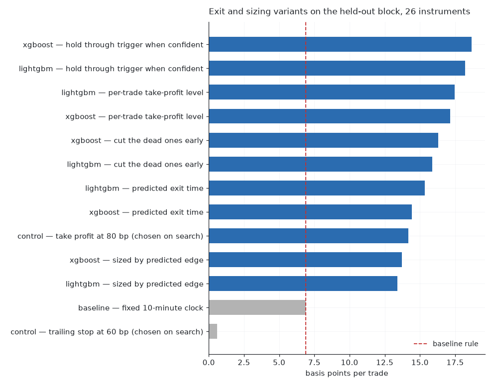
</picture>

### The state it requires, measured

| | Where it works | Where it does not |
|---|---:|---:|
| **Index 10-minute autocorrelation** | **−0.1014** | **−0.0003** |
| Index move over the span | +49.8% | −33.1% |
| Dispersion of daily moves | 265 bp | 483 bp |

<picture>
  <source media="(prefers-color-scheme: dark)" srcset="docs/images/reversion_horizon_profile_dark.png">
  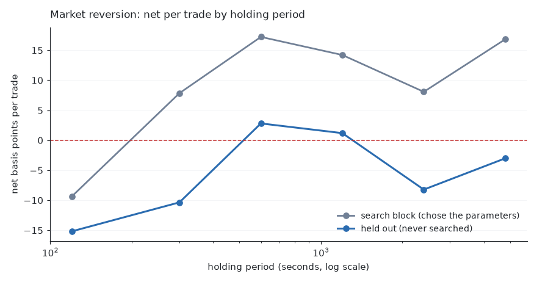
</picture>

The holding-period profile is the mechanism made visible: two minutes loses, ten
is best, longer decays — the shape a reverting market produces and a trending one
does not.

### Why

A rising market's ten-minute surge is impatient buying that runs ahead of the
book, and it retraces; the strategy is paid for supplying the other side. A
falling market's ten-minute surge is forced flow — margin being closed — which
does not retrace, because the seller is not choosing and there is more behind.
The rule selects the *largest* ten-minute index moves, which in a cascade are
precisely the continuations. That predicts the sign of the failure, and gross
went from +20.50 to −5.07 rather than to zero.

### The boundary

Three attempts to escape the condition, all measured, all negative: daily
refitting of the threshold, daily re-estimation of the sign, and a gate that
trades only when trailing autocorrelation is low. The gate fails in the
informative direction — the days it admits are *worse* than the days it rejects,
in all four windows tried.

So: **the state is measurable, and on this evidence not forecastable a day
ahead.** The effect is real and conditional; deploying it needs a regime forecast
this project does not have. Anyone continuing should start there, not with the
trading rule, which is the easy half.

### And what fourteen days is worth

The +6.99 figure counts each trade as an observation, and 26 instruments carry
one market-wide bet — their per-day results correlate at +0.47. By day it is
+6.18 bp over 14 days, *t* = 1.18, 8 days positive. That establishes the effect
was present and how large; it does not establish persistence, which the six weeks
that followed then settled. Both statistics are computed for everything in this
repository by
[`evaluation/significance.py`](src/trading_research/evaluation/significance.py).

---

## What does not work: direction from one instrument's own book

Run first on Binance best-bid-ask for BTCUSDT and XRPUSDT in early 2024, and
then on Bybit's full order book for BTCUSDT (83 days) and BICOUSDT, CRVUSDT and
XRPUSDT (38 days each), the pipeline reaches a definite negative conclusion and
— more usefully — explains it.

Short-horizon direction **is** predictable. Queue imbalance correlates with the
next second's mid return at about 0.27, decaying to roughly 0.02 by ten
minutes. That is real signal, and it is reproducible.

It is also not enough. A taker round trip costs about 11 bp on Binance USD-M and
12–16 bp on Bybit, depending on the instrument's spread: a fee each side, plus
the spread, plus slippage. Against that, the best gross edge the corrected
searches produced is +3 to +9 bp per trade on the block that chose it — short by
a factor of two to four — and on the block that chose nothing, two of the three
winners have a gross edge of the wrong sign. No fold, on any instrument, at any
horizon tested, was profitable after costs.

The mechanism is visible in one table. Signal strength falls with horizon at
almost exactly the rate volatility rises, so their product — the expected gross
edge per trade — barely moves, while the fee stays fixed. **The horizon where
prediction works and the horizon where trading pays do not overlap.**

Every lever anyone reaches for was tested, and none of them helps. A longer
horizon does not, because within this range the edge is horizon-invariant. A
wider feature set — 194 generated columns against 10 hand-picked — measurably
made it worse. A better fee tier falls short by about a factor of five:
break-even needs roughly 0.3 bp per side against about 1.7 at the top volume
tiers, and even a zero fee leaves under a basis point per trade once the spread
is paid. A sequence model does not. Neither do bagging, random forests,
extremely randomised trees, a second booster, voting, or stacking — and the
[bias-variance decomposition](docs/results.md) says why: prediction variance is
negligible for all eight candidates, so there is nothing for averaging to
remove, and the models explain under 0.03% of the forward move.

Nor does *how* the strategy is run. Six exit rules, a market gate, four targets,
five rule-based strategies, a daily choice between them, retraining frequency,
refitting at detected regime breaks, and a full grid of training-window against
apply-window lengths — 672 cells of the last, of which three were positive, with
the two axes moving the median by 0.9 and 0.3 bp against a 13 bp cost.

And the learning is not what produces what edge there is. Trading the queue
imbalance directly — one feature, no model, no parameters — beats logistic
regression, gradient boosting and their ensemble on gross edge per trade, on
both instruments, through identical machinery. The models' extra apparatus
mostly buys selectivity, which the cost floor then eats.

<picture>
  <source media="(prefers-color-scheme: dark)" srcset="docs/images/strategies_btc_dark.png">
  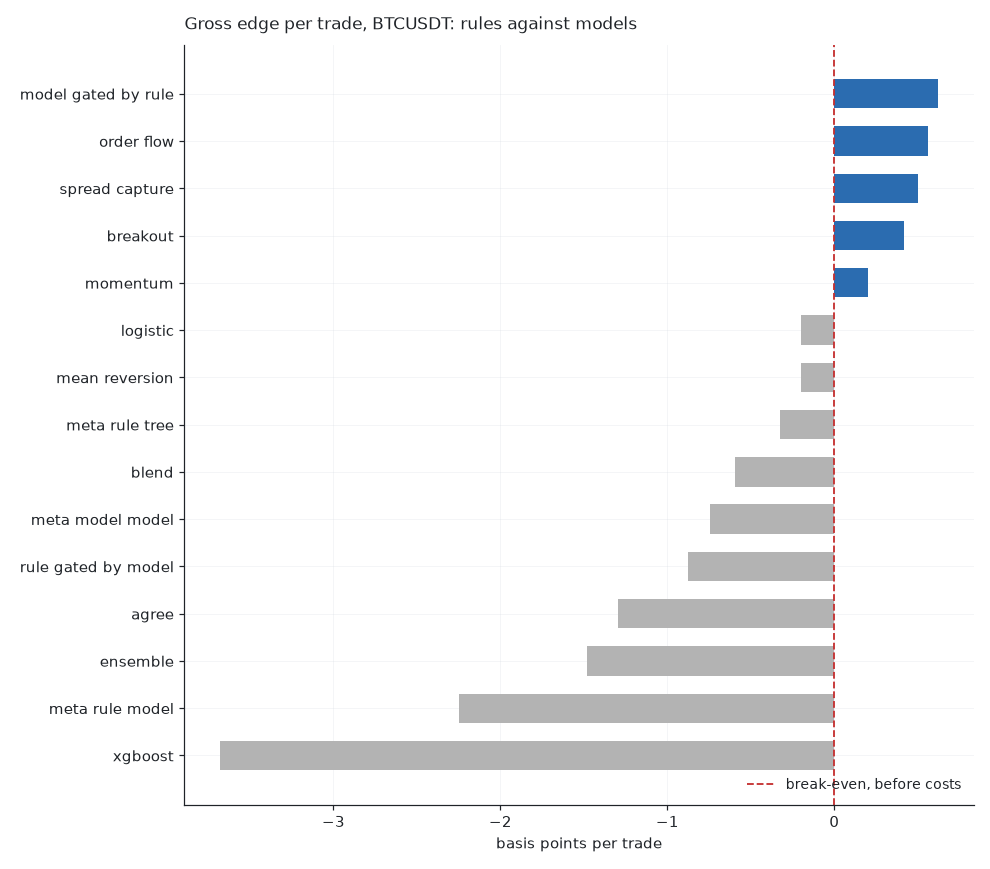
</picture>

Given five strategies and a daily choice between them — including the choice
not to trade — the selector stands aside on every single day it is offered
(§15). It is not a strategy that failed to find an edge; it is one that
identified in real time that there was none and acted accordingly. The
configurations that trade are the ones forbidden from declining, and they lose
around 2,600 bp of notional a day doing it.

One lever does move the number: **how often the model is retrained.** Fitting on
a fortnight and refitting every day — schedule chosen on validation, applied
once to test — raises XRP's gross edge to 12.31 bp against a 12.68 bp cost. That
is a shortfall of 0.37 bp rather than the ~10 bp gap everywhere else, and it is
still a loss: negative in sign, over 141 trades, with fewer than half its windows
positive. It is the closest this study gets, and close is not across.

<picture>
  <source media="(prefers-color-scheme: dark)" srcset="docs/images/bt_equity_dark.png">
  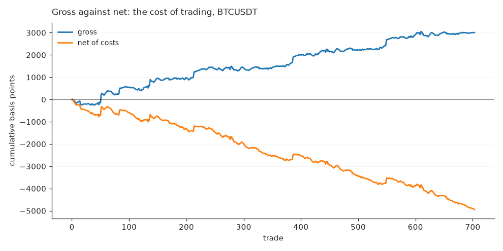
</picture>

The whole study in one figure — the best BTCUSDT configuration's own trades,
rebuilt from the committed table by
[`scripts/render_readme_charts.py`](scripts/render_readme_charts.py): the
model's calls are right often enough for the gross line to climb three thousand
basis points, and the cost of crossing the spread takes the same trades eight
thousand the other way.

### Where the ceiling actually is

The audit in [§28](docs/results.md) measures each source of information before a
model is chosen, which is the order this project should have used from the
start. Fitting a model and looking at the money answers "did this arrangement
work" and never answers "was there anything here to find", so every negative
result before the audit was ambiguous.

At a two-minute horizon on BICOUSDT, the best single column of the touch
plane — the plane every earlier section used — reaches an information
coefficient of 0.022 out of sample. Break-even needs about **0.08 to 0.10**,
measured by blending predictions with the realised future at increasing weight
until profit crosses zero. The best of everything tried, over sixteen model
types, reaches 0.023.

So the ceiling was never the model, and no arrangement of trees, ensembles,
stacking or networks moves it. The bias-variance decomposition says why:
prediction variance is negligible, so averaging has nothing to remove, and the
models explain under 0.03% of the forward move.

The cross-sectional column that reached 0.046 — twice the best own-book
feature — is what sent this project after the reversion candidate above. That
0.046 was real on the span it was measured on, and the six weeks that followed
say it was a property of those weeks.

See [`docs/results.md`](docs/results.md) for the full picture,
[`docs/findings.md`](docs/findings.md) for the register of every candidate and
its status, and [`docs/limitations.md`](docs/limitations.md) for what none of it
establishes. No backtest here should be read as evidence that any strategy is or
was profitable.

---

## Market making: quoting both sides on public Bybit data

**The result: all four pre-registered hypotheses are killed** on the held-out
fortnight, read once. On the one instrument whose spread admits a market maker,
quoting loses to the move that follows its fills; stepping inside the spread,
leaning on the reversion state, resting on the reversion signal and pulling back
after regime flags each failed a condition written down before the test. No
strategy there breaks even at any maker fee Bybit publishes.

**What was pre-registered.** Before any market-making code existed,
[`docs/preregistration/market_making.md`](docs/preregistration/market_making.md)
and [`configs/mm_prereg.yaml`](configs/mm_prereg.yaml) (commit `cb4ae4c`) fixed
the blocks, the instrument admission rule, three hypotheses with their kill
conditions and placebos, and the rule that the held-out fortnight is read once.
Amendment 1 recorded simulator corrections found in review, before any result;
Amendment 2 froze every value searched on the 25-day development block, with the
configuration's hash, before the held-out block was opened. The hypotheses:

- **H1** — quoting one tick inside a wide spread, first in the queue, earns a
  positive net and more than the same quoter without the rule;
- **H2** — the reversion state of [§27](docs/results.md#27-cross-sectional-reversion-and-the-market-state-it-requires)
  pays a market maker that leans against the index's move (H2.1), and passive
  execution of the frozen reversion signal beats crossing for it (H2.2);
- **H3** — widening quotes after a regime-break flag earns more than quoting
  through it.

**The held-out fortnight was read once**, 26 February to 9 March 2024, through a
ledger that refuses to open it unless the frozen configuration is committed and
the tree clean, and records the read
([`mm_heldout_ledger.json`](experiments/results/mm_heldout_ledger.json): commit
`2a7daaa`, 2026-10-04 12:34:52 UTC). Every day of every instrument was simulated
and none was excluded.

**The simulator, in six rules.** Built first, tested on synthetic markets with
known answers, and documented rule by rule with the direction each one biases a
result in [`docs/market_making_simulator.md`](docs/market_making_simulator.md):

1. **Fills only from prints.** A resting order fills only when a print reaches
   its price from the side that hits it, never because a snapshot moved.
2. **A queue per order.** It joins the tail of the visible size, moves up only
   as prints consume what is ahead, and gains on cancellations by a rule that is
   bracketed — and a verdict must survive the pessimistic bracket.
3. **Latency.** Orders, cancels and flattens take 10 ms; a cancel in flight
   does not protect the order; a price change loses priority.
4. **Own size and limits.** A tenth of the touch at most; soft and hard
   inventory limits; past the soft limit a reduce-only taker order flattens
   back, walking the first book after it arrives.
5. **Fees and funding.** Maker fee on passive fills, taker fee on flattens,
   funding on the position held at each settlement; days start and end flat.
6. **What it does not model.** The book is a 100 ms photograph, so queue
   dynamics inside 100 ms are a stated rule rather than an observation; own
   impact on others is ignored; a snapshot that crosses an order fills nothing
   without a print, which is optimistic and is bracketed. A day whose stored
   book lost messages, or whose flatten found no fresh book, is flagged and
   kept out of every verdict.

### What each increment earns

BICOUSDT, the only instrument the admission rule (spread at least twice the base
maker fee, two ticks or more a quarter of the time) let through, over the
held-out fortnight, USDT a day
([`mm_strategies_H.csv`](experiments/results/mm_strategies_H.csv)):

| Strategy | Net | Net, bp of turnover | Fills a day | RMS position (BICO) | Spread | Adverse, 5 s | Inventory | Fees | Funding |
|---|---:|---:|---:|---:|---:|---:|---:|---:|---:|
| S0 at the touch | −43.41 | −5.00 | 12,277 | 103 | +21.49 | −47.26 | −0.30 | 17.37 | +0.03 |
| S1 skewed, gated | −1.20 | −7.50 | 192 | 56 | +2.45 | −2.96 | −0.35 | 0.33 | −0.01 |
| S2 + one tick inside | −1.21 | −7.54 | 192 | 56 | +2.45 | −2.96 | −0.37 | 0.33 | −0.01 |
| S3 + regime guard | −1.10 | −7.93 | 164 | 58 | +2.02 | −2.51 | −0.30 | 0.28 | −0.01 |
| S4 + reversion lean | −0.65 | −2.64 | 316 | 72 | +2.43 | −3.15 | +0.58 | 0.50 | −0.01 |
| X1 passive reversion | −0.06 | −8.14 | 10 | 0.5 | +0.02 | −0.05 | −0.02 | 0.01 | 0.00 |

The clip is a tenth of the touch, about 20 USDT, so the amounts are small; the
sign and the basis points are the point. Every row is negative, and stays
negative under every cancellation rule, arrival rule and latency from 1 to
250 ms ([`mm_robustness_H.csv`](experiments/results/mm_robustness_H.csv)).

### Where the money goes

The touch quoter earns its spread and gives back more than twice as much to the
move in the five seconds after it is filled. The fills that reach a resting
order through the queue are worth something; the ones a print trades straight
through are worth −3.8 to −4.6 bp at five seconds, and for the gated quoters
they are three fills in four. On BICOUSDT every strategy's passive fills, taken
together, are worth less than being the passive side of the average print (the
dashed line).

<picture>
  <source media="(prefers-color-scheme: dark)" srcset="docs/images/mm_markouts_dark.png">
  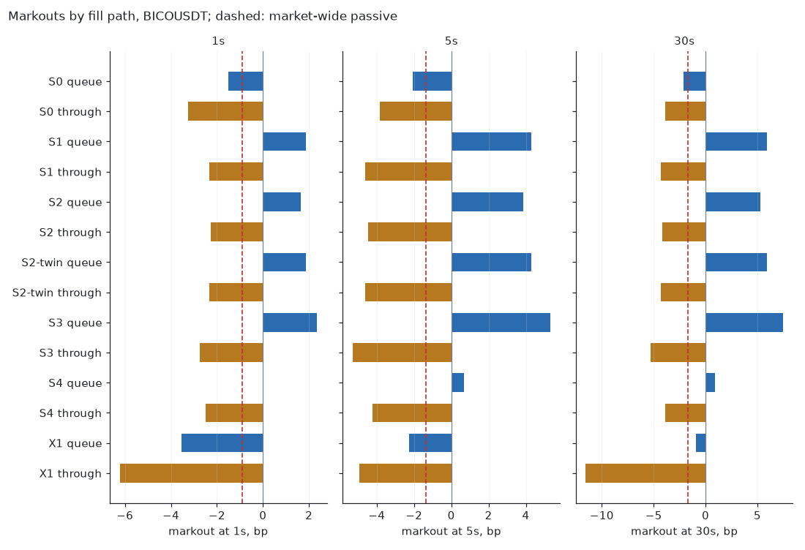
</picture>

<picture>
  <source media="(prefers-color-scheme: dark)" srcset="docs/images/mm_decomposition_dark.png">
  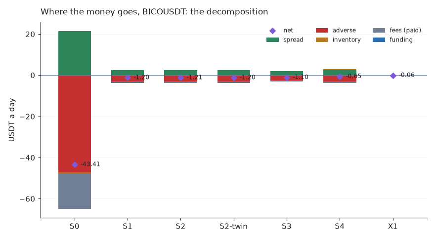
</picture>

### Inventory

S1, the quoter every hypothesis is compared against, held a root-mean-square
position of 56 BICO (about 25 USDT) against a soft limit of six clips, and was
flattened back to that limit twice in thirteen days.

<picture>
  <source media="(prefers-color-scheme: dark)" srcset="docs/images/mm_inventory_dark.png">
  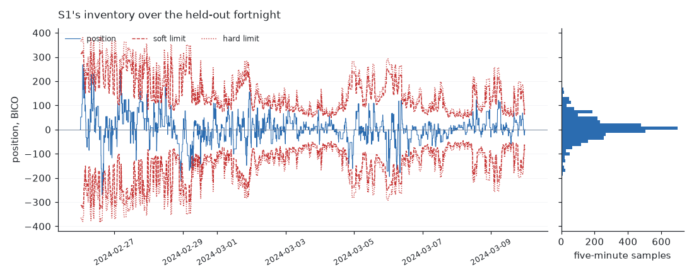
</picture>

### The three hypotheses

| Hypothesis | Metric | Value | Day t (12 df) | Kill conditions that fired | Status |
|---|---|---:|---:|---|---|
| H1 inside the spread | S2 − twin, paired daily, USDT | −0.007 | −0.93 | K1 net ≤ 0, K2 no gain over the twin, K4 the stale placebo gains as much, K-fund | **killed** |
| H2.1 lean on the state | S4 − S1, paired daily, pooled, USDT | −91.81 | −0.55 | K1 no gain, K3 below the shuffled-state placebos, K-fund | **killed** |
| H2.2 rest on the signal | X1 − taker, net per attempt, bp | −9.96 | −1.78 | K1, K2 X1 itself loses (−4.92 bp), K3 following the move does as well, K4, K-fund | **killed** |
| H3 regime guard | S3 − S1, paired daily, USDT | +0.107 | +0.62 | K2 no better than the same flags at random times | **killed** |

None passes Holm's procedure across the four, and none needed to fail it: each
is killed by a condition stated in advance. The secondary H2.3 reads the
boundary block as well and waits for it. Every condition with the value it read
is in [`mm_kill_conditions_H.csv`](experiments/results/mm_kill_conditions_H.csv)
and in the pre-registration's
[results section](docs/preregistration/market_making.md#results-on-block-h-read-once-4-october-2026).

H2.2 was the maker case for the reversion result above: a resting order on the
fading side fills exactly when the move it fades is happening. On the same 376
triggers the taker version earned +6.38 bp per trade, as §27 found on this
fortnight, and the passive version lost 4.92 bp per attempt.

### Placebos

The real difference (red) against 50 placebos each: the reversion tape shifted
by one to twelve days and an hour or more (H2.1, H2.2), and the regime flags
moved around the fortnight with their count and spacing kept (H3). A hypothesis
survives only above the dotted 95th percentile; none is.

<picture>
  <source media="(prefers-color-scheme: dark)" srcset="docs/images/mm_placebos_dark.png">
  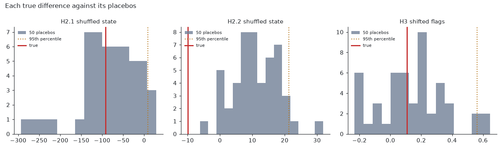
</picture>

### What it would take

The advantage ladder adds one advantage at a time to the touch quoter, on all
four instruments; from rung 2 each reads the future and is an upper bound, not
a strategy. Being first in the queue fills about twice as often and loses
more. On BICOUSDT nothing short of perfect foresight of the next second makes
the touch quoter pay; on the tighter instruments a forecast with an R² of 0.1 to
0.3 would.

<picture>
  <source media="(prefers-color-scheme: dark)" srcset="docs/images/mm_ladder_dark.png">
  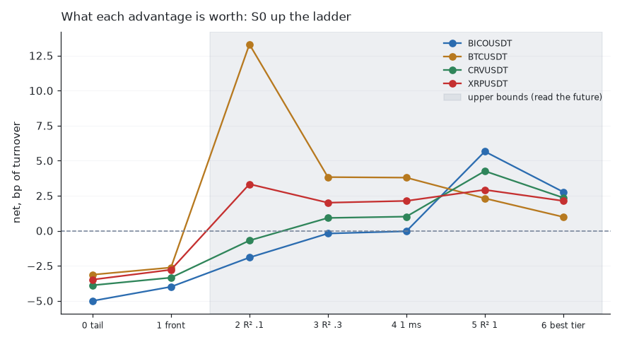
</picture>

### The fee that would make it pay

The maker fee at which each strategy's net over the fortnight is zero, against
Bybit's published linear-perpetual schedule, transcribed in October 2026 and
applied to 2024 (the schedule may have differed then). The best published maker
fee is 0 bp and the market-maker programme advertises up to a 1 bp rebate; on
BICOUSDT, S0 would need −3.0 bp. Only S4 on CRVUSDT and XRPUSDT, and S1 there,
whose profit was carried inventory rather than quoting, cross the line at a
published tier.

<picture>
  <source media="(prefers-color-scheme: dark)" srcset="docs/images/mm_fee_breakeven_dark.png">
  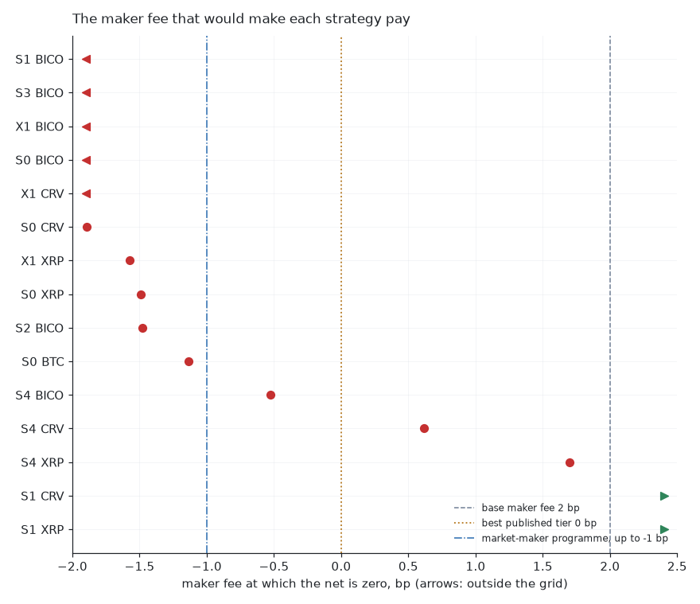
</picture>

### Outside the state

The boundary block (12 March to 7 April, where §27's reversion state is absent)
is read once, after these results are committed, by the next pull request. It
decides H2.3 and records H2's boundary predictions; it cannot revive a
hypothesis killed here.

### What this does not establish

One admitted instrument and thirteen days, so a minimum detectable effect of
about 0.9 USDT a day against a quoter that loses about 1.2; a 100 ms conflated
book, with queue dynamics inside it a bracketed rule rather than an
observation; no own impact; a 2026 fee schedule applied to 2024 data; and a
fortnight whose reversion signal had been read before by takers, so only the
execution increment was new information.

**In one paragraph.** Tested as registered, market making
on public Bybit data does not pay here at the base fee: the spread a quoter
captures is smaller than the move that follows its fills, and none of the three
ideas registered to change that — stepping inside the spread, leaning on or
resting on the reversion state, or stepping back after regime breaks — survived
its own kill conditions on a fortnight that played no part in choosing it.
Resting on the reversion signal, the one place the earlier negative maker result
might have reversed, loses where crossing for the same signal wins. What the
ladder and the fee break-even add is the size of the gap: a rebate three times
the largest advertised, or a forecast of the next second no public data here
provides.

### A second round, on wide-spread instruments: all five hypotheses killed

Is there any condition under which this market maker earns money? A second
round asked it on data no market-making code had read, registered before a
single file of it was fetched
([pre-registration](docs/preregistration/market_making_round2.md), with
[`configs/mm_prereg_round2.yaml`](configs/mm_prereg_round2.yaml)). Of eight
wide-spread candidates, six were admitted on the 25-day development block
(ALICE, ALGO, JTO, ZEC and GALA by a tick of at least 4 bp, CAKE by round
one's rule), every searched value was frozen
([amendment](docs/preregistration/market_making_round2.md#amendment-1-2026-10-04-before-any-held-out-read-values-frozen-on-the-development-period)),
and the held-out fortnight was read once, with BICOUSDT's four pristine weeks
from 8 April 2024 for B4
([results](docs/preregistration/market_making_round2.md#results-of-the-first-held-out-read-read-once-4-october-2026)).

**Nothing survives: on the held-out data neither the wider spreads, nor
quoting only while the recent market left room, nor a professional fee tier
made this market maker pay from making markets.**

| Hypothesis | Held-out net, USDT per 100 USDT of clip a day | Killed by |
|---|---:|---|
| B1: the quoter, re-searched per instrument, at the base fee | −0.067 | K1, K-nbhd |
| B2: quoting only while the trailing room clears the fee, against quoting throughout | +0.026 (+0.092 over it) | K3 (no better than a time-shifted gate), K-queue, K-dir |
| B3a: the same quoter at the 0 bp maker tier | +0.845 | K-dir: the making part −1.32, the rest inventory |
| B3b: at the programme's −1 bp rebate | +2.217 | K-dir: the making part −0.78 |
| B4: the room gate on BICOUSDT's pristine weeks | −0.347 (−1.83 under its base) | K1, K2, K3, K-fund, K-nbhd |

The positive nets at the professional tiers are inventory carried through a
fortnight of broad rises, which the registration's K-dir was written to catch:
the quoter's spread less the move after its fills and the fees is negative on
every instrument at the base fee, and on all but three instrument-tier pairs
at the professional tiers. No hypothesis is
`candidate` or positive-and-inconclusive, so the basket's pristine weeks are
not read. How far each was from paying, the measure the registration fixes for
this case: the touch quoter would have broken even at a maker fee of −1.7 to
−3.1 bp, a rebate larger than any published.

<picture>
  <source media="(prefers-color-scheme: dark)" srcset="docs/images/mm_round2_fee_breakeven_dark.png">
  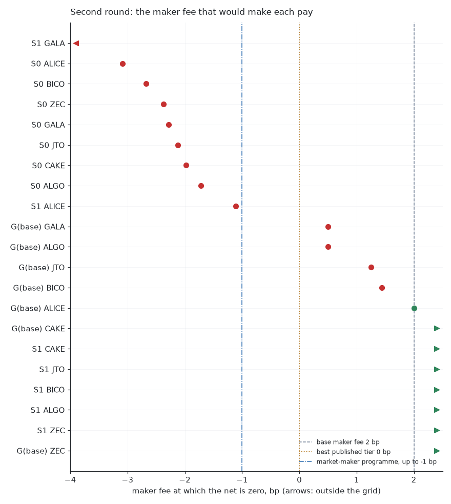
</picture>

S0's break-even is exact; S1 and G(base) were re-run over maker fees from −1.5
to +2.0 bp, and an arrow marks one beyond that range. S1's arrows to the right
are the inventory gains above, not making.

---

## Methodology

Four rules hold everywhere, each a test that fails rather than a caveat:

1. **No look-ahead, checked mechanically.** Every feature declares how many
   observations it looks back; the tests change the data after a cutoff and
   fail if any value before it moved. That catches centred windows, backward
   fills and normalisation fitted on the whole sample.
2. **Purging and embargo, derived.** A label at *t* reads prices to *t + H*, so
   the split derives the embargo from the label's declared horizon instead of
   leaving it to be set by hand.
3. **One cost model.** The same fees, spread and slippage at labelling, at the
   decision and in the profit and loss; fees are read from the tables `trp fees`
   lists, each with its source.
4. **Kill conditions before the test.** [`docs/findings.md`](docs/findings.md)
   lists every candidate with its status (candidate, confirmed, killed,
   artefact) and the condition that would refute it, written in advance; a
   registered study adds a held-out block read once through a ledger.

| Document | Contents |
|---|---|
| [`data_contract.md`](docs/data_contract.md) | Column semantics, units, time conventions, quality rules |
| [`methodology.md`](docs/methodology.md) | Features, labels, splits, model comparison protocol |
| [`execution_assumptions.md`](docs/execution_assumptions.md) | Cost model, fills, what each execution mode (taker, passive entry, market maker) does and does not simulate |
| [`market_making_simulator.md`](docs/market_making_simulator.md) | The event-time market-making simulator: every rule, the direction of its bias, and the test that pins it |
| [`synthetic.md`](docs/synthetic.md) | The generators with planted answers, and what each check proves and does not |
| [`extending.md`](docs/extending.md) | Plugins: the five kinds, the decorator, the conformance checks |
| [`paper_trading.md`](docs/paper_trading.md) | The paper loop, the parity guarantee, the kill switch |
| [`agents.md`](docs/agents.md) | The agent harness: roles, policy, logs, each rule with its test |
| [`limitations.md`](docs/limitations.md) | What this does not establish |
| [`preregistration/`](docs/preregistration/) | Every registered study, committed before its held-out data was fetched |
| [`results.md`](docs/results.md) | Every experiment, numbered, with the script that produced it |

Reproducibility: one seed per run, recorded in its manifest with the full
configuration; datasets carry a `manifest.json` of their provenance; every
assumption that moves a number lives in a configuration file. CI runs lint,
types, tests, the end-to-end demo and a repository audit
(`scripts/audit_repo.py`: private paths, credential-shaped strings, notebook
outputs, oversized binaries).

---

## Data

**Synthetic (default).** A generated market with volatility regimes, a
liquidity state, a spread that widens under stress, geometric depth decay, and
Poisson trade arrivals that execute against the book. It exists for tests, CI
and the quickstart. It is *not* evidence about markets: every row is stamped
`source="synthetic"` and every artefact carries a warning, because a synthetic
backtest measures the agreement between a generator and a model and nothing
else.

**Public exchange data.** Two venues, for two different things.

*Binance* publishes best bid and ask, aggregated trades, open interest and
funding as daily archives, and bars (`klines`) at every interval as monthly
ones. Used for the instrument screen, which needs breadth rather than depth,
and — the bars — for regime monitoring, which needs years rather than days.
Note that daily `bookTicker` archives stop after 30 March 2024, which is why the
screen can be measured on two windows and not more.

*Bybit* publishes the **full order book** as an incremental stream — a snapshot
and its deltas — which reconstructs to ten levels a side, and publishes trade
prints carrying the aggressor's side. Everything from §24 onward runs on these:
the depth features need the levels, and the maker model needs the prints,
because a book says what was offered and only a print says what was taken.

**Nothing under `data/` is in version control.** A day of one instrument's book
is hundreds of megabytes.

**The code fetches what it needs.** Every experiment declares its instruments
and span, and [`data/ensure.py`](src/trading_research/data/ensure.py) compares
that against what is on disk and downloads only the gaps. A clean checkout
therefore runs — slowly the first time, instantly afterwards. Three properties
are deliberate:

- an interrupted run resumes rather than restarts, since a day already present
  is never fetched twice;
- a day the venue does not have is reported and skipped, not raised — an
  instrument listed mid-span has no archive before it existed — while a *total*
  absence does raise, so an experiment cannot quietly run on nothing;
- nothing downloads silently: each call prints what it will fetch first, and
  `dry_run=True` answers the question without acting.

```python
from datetime import date
from trading_research.data.ensure import ensure_bars, ensure_book, ensure_universe

# ten levels a side, about two minutes of replay per day
ensure_book("DOGEUSDT", date(2024, 2, 1), date(2024, 3, 10))

# top of book only for a cross-section: eleven seconds per instrument-day
ensure_universe(["BTCUSDT", "ETHUSDT"], date(2024, 2, 1), date(2024, 3, 10))

# daily bars for regime monitoring: a few kilobytes a month
ensure_bars("BTCUSDT", "1d", date(2024, 1, 1), date(2026, 9, 30))
```

The venue rate-limits sustained downloading. A stalled fetch is the venue, not
the code; wait and re-run, and it resumes from where it stopped.

**Synthetic data** remains the default for tests and the quickstart, so neither
needs the network.

---

## Limitations

Stated plainly:

- **No profitability claim is made.** No result in this repository should be
  read as evidence that any strategy is or was profitable.
- **Synthetic results are circular.** They demonstrate that the pipeline works,
  not that markets behave this way.
- **The backtest is a simulation.** The taker backtest does not model queue
  position, partial fills against a real book, latency, market impact, or the
  fact that a real order changes the book it is trading against. The
  market-making simulator models queue position, partial fills and latency, but
  from a 100 ms book rather than a message feed, with cancellations attributed
  by rule, own impact ignored, and a crossed snapshot filling nothing without a
  print — each stated with its direction in
  [`docs/market_making_simulator.md`](docs/market_making_simulator.md). Its
  verdicts rest on one admitted instrument and thirteen held-out days.
- **Public data is coarser than production data.** Exchange archives are
  aggregated; a real system runs on a live feed with different timing.
- **Short horizons are the hardest regime for this.** Costs dominate, edges are
  thin, and results are unstable across periods. Where that shows up, it is
  reported rather than tuned away.

---

## Disclaimer

This is research and engineering code published as a portfolio and a teaching
artefact. It is **not** investment advice, **not** a trading system, and
**not** a claim about future returns. Backtested results — including any shown
here — are computed with the benefit of hindsight under stated assumptions, and
do not establish that a strategy would have been profitable in live trading or
would be profitable in future.

## License

[MIT](LICENSE).
