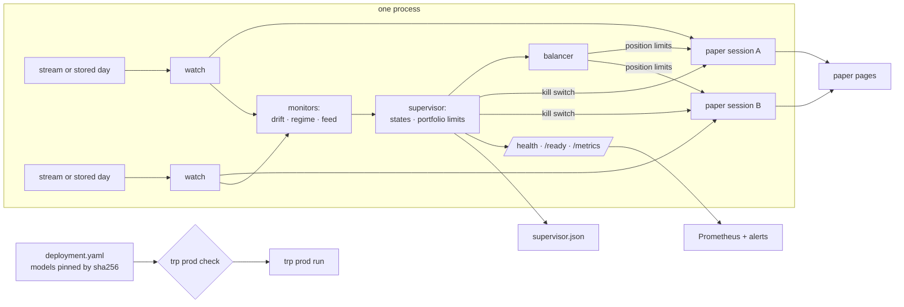

# Production

The step after paper trading: the strategies a backtest validated, frozen, run
together as one portfolio that is supervised, balanced and observable. The
broker is still the paper ledger — no order reaches a venue and no key is read —
so everything below can be run, tested and watched before an order path exists.



## Run it

```bash
trp prod check deploy/deployment.example.yaml
trp prod run deploy/deployment.example.yaml --day btc-taker=data/demo --day eth-passive=data/demo
trp prod run deploy/deployment.example.yaml --minutes 60      # live public streams
trp prod status runs/prod/<run>
docker compose -f deploy/docker-compose.yml up --build        # the image and Prometheus
```

`check` reads every field, puts the whole file through the paper step's key
guard, loads each model and compares it with the sha256 the deployment pins: the
file the backtest validated is the only one a deployment may run. `run` refuses
on the same grounds, then starts one paper session per strategy on its own
thread, each exactly as `trp paper` builds it.

## The deployment file

[`deploy/deployment.example.yaml`](../deploy/deployment.example.yaml) is the
annotated example. Per strategy: venue, market, symbol, model and its pin,
execution (taker, passive or maker), clip, hold, and `expected`: the held-out
backtest's net and standard deviation per round trip, which the drift monitor
holds the live result to. For the portfolio: capital, the share deployed
(`max_gross`), the most any strategy may take (`max_weight`), a daily loss and a
drawdown in quote currency.

## States

| State | Entered on | What changes |
|---|---|---|
| `running` | start | the balancer's weight sets the position limit |
| `reduced` | a regime alarm | the strategy counts at half its weight |
| `halted` | a drift alarm, a stale feed, the session's own kill switch, the portfolio's daily loss or drawdown, an error | limit zero, the session's kill switch latched with the reason, so it flattens what it holds |

`halted` latches for the run: a strategy starts again only in a new run, after
someone has read why it stopped. Every transition is kept with its reason, its
event time and its wall time.

## Monitors

| Monitor | Statistic | Alarm | Measured |
|---|---|---|---|
| Drift | one-sided CUSUM of `(expected - net) / sd - k` per round trip | above `h` after `min_trades` | quiet over 300 round trips drawn from the backtest's own distribution; a shortfall of 1.5 sd a trade is caught by the 10th–30th |
| Regime | CUSUMs on the mid's return mean (`±z - k`) and on the variance's log-likelihood ratio for a doubling or a halving, standardised on the first `warmup` samples | above `h` | at the defaults (`h` 12, sampled every second): one false alarm in 96,000 calm samples over 40 seeds; a doubling of volatility flagged after a median of 14 samples |
| Feed | seconds since the last book row, by the wall clock | above `stale_after_s` | — |

The figures are those of `tests/test_production.py` and the measurement that
chose the variance statistic: a `z² − 1` sum rides the chi-square's right tail
into an alarm every few hundred calm samples; the likelihood ratio drifts down
while nothing changes.

## The balancer

Weights inverse to each strategy's volatility per round trip, so each
contributes about the same risk; `reduced` counts half, `halted` nothing; no
weight above `max_weight`, applied by water-filling, the rest left undeployed
when every strategy is capped. The volatility is the backtest's until a
strategy has closed `min_trades` round trips live, its live figure after, and
the balancer runs again on every state change and every `min_trades` round
trips. The weight becomes a scale on the strategy's position limit, which the
supervised ledger applies to every order that would grow the position; orders
that reduce it always pass.

## Health and metrics

| Path | Answer |
|---|---|
| `/health` | 200 and the supervisor's snapshot as JSON while the process serves |
| `/ready` | 200 while a strategy may trade on a fresh feed, else 503 |
| `/metrics` | Prometheus text: portfolio equity, day P&L and drawdown; per strategy state, equity, position, fills, round trips, weight, each monitor's statistic and threshold, feed age and gaps |

[`deploy/alerts.yml`](../deploy/alerts.yml) pages on a halted strategy, a stale
feed or a silent process, and opens a ticket on a reduced strategy, a drift
statistic past 80% of its threshold or a drawdown held for half an hour; a test
checks that every series an alert reads is one the endpoint serves. CI builds
the image and checks the example deployment inside it.

## What is not here

- **An order path.** The broker is the paper ledger. A venue adapter — keys from
  a secret store, order and cancel calls, reconciliation of the venue's fills
  against the ledger's — is the next piece, and the key guard refuses every
  deployment until it exists.
- **State across restarts.** A run starts flat and `running`; a halted strategy
  is halted until the run ends, and the record of why is `supervisor.json`.
- **More than one host.** One process runs every strategy of a deployment; two
  deployments are two processes with two ports.
- **Calibrated thresholds per strategy.** The monitors' defaults are measured on
  synthetic series; a strategy's own `h` should be set from its backtest's
  round trips the way the drift test sets it.
