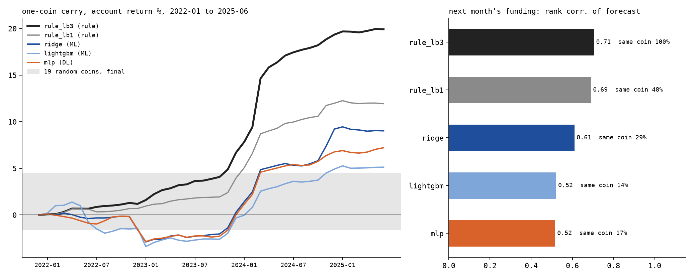

# Machine learning choosing the carry's coin: 2022-01 to 2025-06

Written by `experiments/carry_ml_report.py` from `development.json`
([registration](../../../docs/preregistration/carry_ml_2026_11.md)). Each chooser holds one coin a
month as a delta-neutral carry, the whole account, at Binance Regular fees, through the carry
search's engine. The models are refitted every month on the months already ended.
**A measurement on development months**, read before by the carry search; no status.

| chooser | kind | total % | a year % | Sharpe | worst drawdown % | losing months | forecast corr. | same coin as `rule_lb3` | coin changes |
|---|---|--:|--:|--:|--:|--:|--:|--:|--:|
| `rule_lb3` | rule | +19.8 | +5.3 | 1.91 | -0.1 | 6 | 0.71 | 100% | 12 |
| `rule_lb1` | rule | +11.8 | +3.2 | 2.00 | -0.3 | 7 | 0.69 | 48% | 33 |
| `ridge` | ML | +8.9 | +2.5 | 1.06 | -3.1 | 16 | 0.61 | 29% | 32 |
| `lightgbm` | ML | +5.0 | +1.4 | 0.65 | -4.7 | 11 | 0.52 | 14% | 35 |
| `mlp` | DL | +7.1 | +2.0 | 0.95 | -3.0 | 14 | 0.52 | 17% | 29 |

Months are the observations (42). Forecast corr.: each month's Spearman
correlation across candidates of the chooser's score and the month's realised funding.

| model | return minus `rule_lb3`, % a month | *t* | forecast corr. minus `rule_lb3`'s | *t* |
|---|--:|--:|--:|--:|
| `ridge` | -0.228 | -2.57 | -0.095 | -3.47 |
| `lightgbm` | -0.315 | -3.03 | -0.184 | -5.17 |
| `mlp` | -0.269 | -3.46 | -0.189 | -6.27 |

- **Highest return: `rule_lb3`**, +19.8%. Nineteen choosers holding a
  coin drawn at random each month ended between -1.6% and +4.5%.
- **Best forecast of the month's funding: `rule_lb3`** (0.71);
  the three-month mean's is 0.71, the models'
  0.52 to 0.61. A chooser that changes coin pays a round trip and
  takes the new coin's basis.
