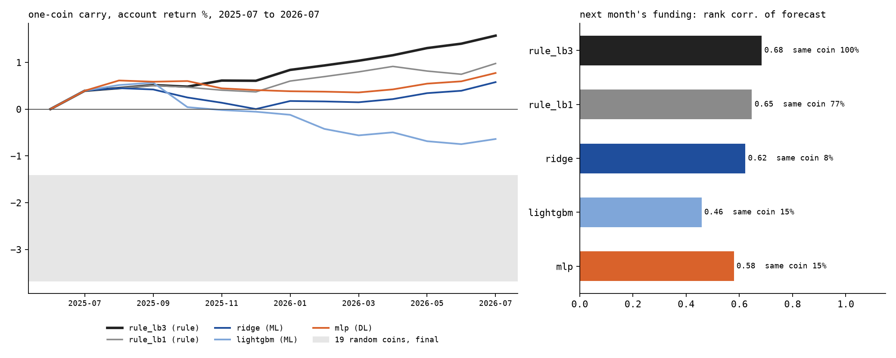

# Machine learning choosing the carry's coin: 2025-07 to 2026-07

Written by `experiments/carry_ml_report.py` from `result.json`
([registration](../../../docs/preregistration/carry_ml_2026_11.md)). Each chooser holds one coin a
month as a delta-neutral carry, the whole account, at Binance Regular fees, through the carry
search's engine. The models are refitted every month on the months already ended.
**Held-out months, read once.** C1 and C2's statuses are in `result.json` and below.

| chooser | kind | total % | a year % | Sharpe | worst drawdown % | losing months | forecast corr. | same coin as `rule_lb3` | coin changes |
|---|---|--:|--:|--:|--:|--:|--:|--:|--:|
| `rule_lb3` | rule | +1.5 | +1.4 | 3.88 | -0.0 | 2 | 0.68 | 100% | 4 |
| `rule_lb1` | rule | +0.9 | +0.8 | 1.81 | -0.2 | 5 | 0.65 | 77% | 7 |
| `ridge` | ML | +0.5 | +0.5 | 1.01 | -0.4 | 6 | 0.62 | 8% | 4 |
| `lightgbm` | ML | -0.7 | -0.7 | -0.77 | -1.3 | 8 | 0.46 | 15% | 11 |
| `mlp` | DL | +0.7 | +0.7 | 1.46 | -0.3 | 6 | 0.58 | 15% | 6 |

Months are the observations (13). Forecast corr.: each month's Spearman
correlation across candidates of the chooser's score and the month's realised funding.

| model | return minus `rule_lb3`, % a month | *t* | forecast corr. minus `rule_lb3`'s | *t* |
|---|--:|--:|--:|--:|
| `ridge` | -0.076 | -3.81 | -0.061 | -1.74 |
| `lightgbm` | -0.169 | -3.54 | -0.226 | -3.43 |
| `mlp` | -0.061 | -1.86 | -0.104 | -2.45 |

- **Highest return: `rule_lb3`**, +1.5%. Nineteen choosers holding a
  coin drawn at random each month ended between -3.7% and -1.4%.
- **Best forecast of the month's funding: `rule_lb3`** (0.68);
  the three-month mean's is 0.68, the models'
  0.46 to 0.62. A chooser that changes coin pays a round trip and
  takes the new coin's basis.

| model | C1, chooses better | Holm *p* | C2, forecasts better | Holm *p* |
|---|---|--:|---|--:|
| `ridge` | **killed** | 1.000 | **killed** | 1.000 |
| `lightgbm` | **killed** | 1.000 | **killed** | 1.000 |
| `mlp` | **killed** | 1.000 | **killed** | 1.000 |
