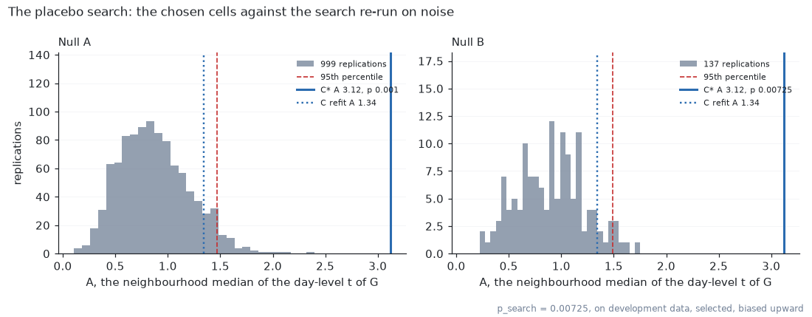
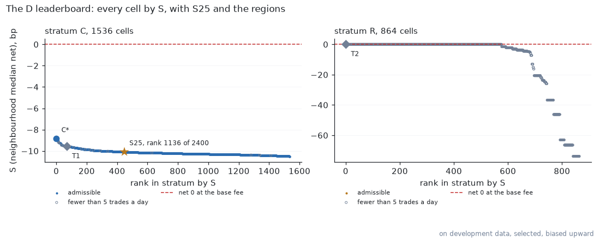
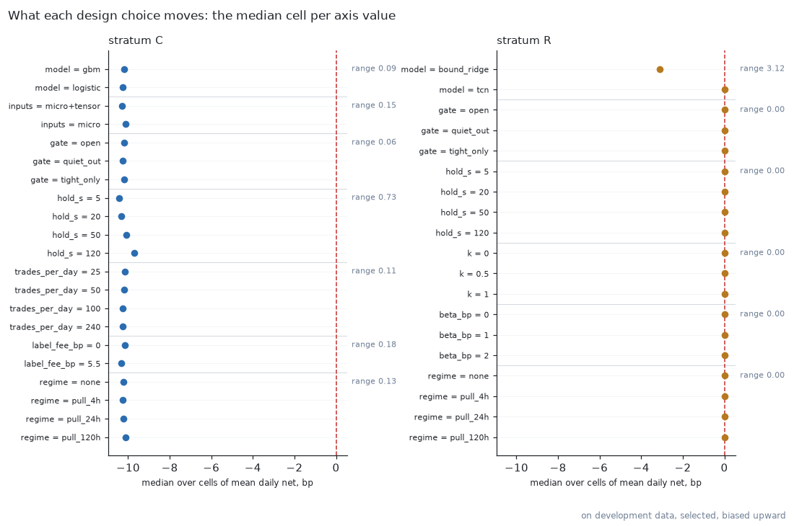
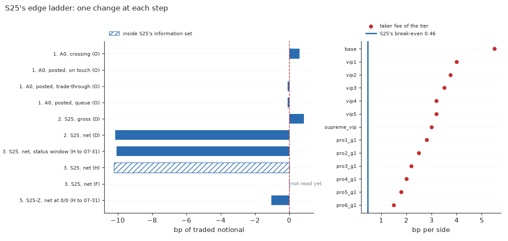
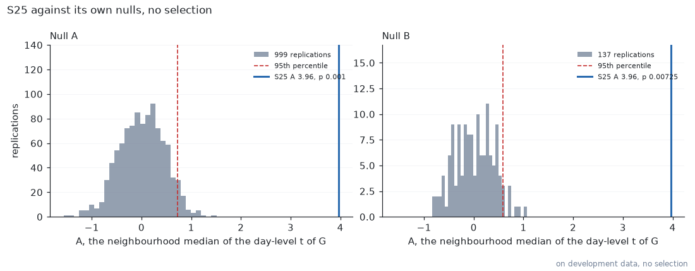
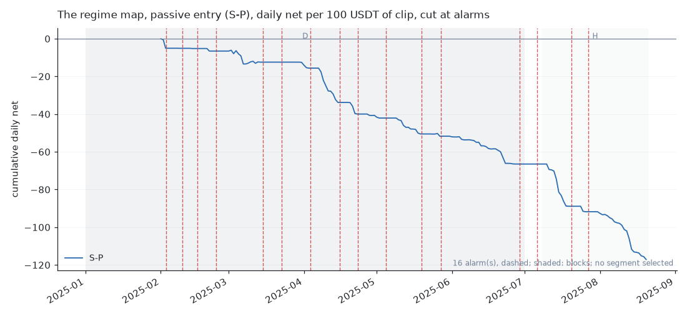
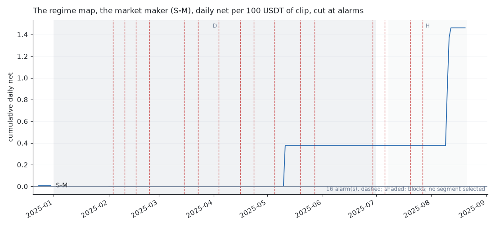
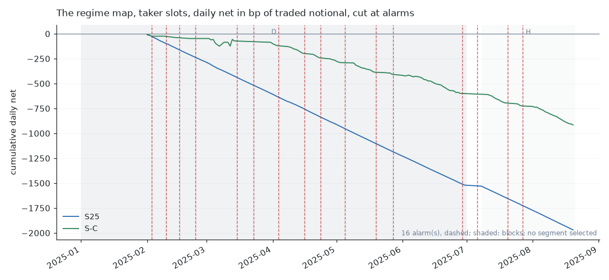
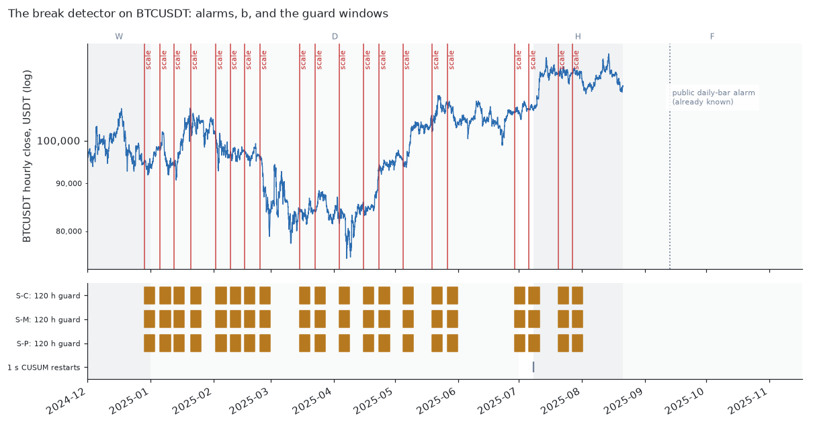
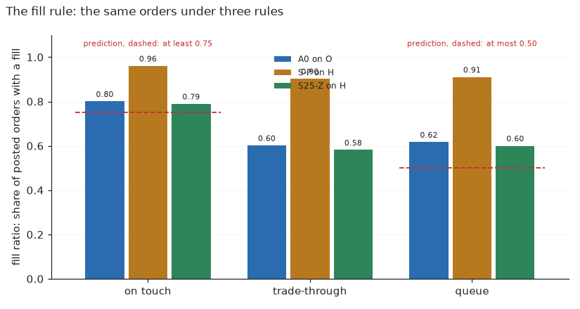

# The 2025 short-horizon search: its pages

Written by the entry point from the stages' records and the blocks' results; blocks read: H. Only H, F and P statuses and p_search are quoted as results; every D number is labelled on development data, selected.

## Headline sentences

- Searched 2,435 configurations (stratum, model, inputs, label fee, hold, decision threshold, market gate, regime policy) on 150 development days of BTCUSDT; on development data, selected, the best direction edge was distinguishable from search noise (p_search = 0.00725; Null A p = 0.001, Null B p = 0.00725; 1 D runs).
- No configuration paid the 5.5 bp taker fee on development data.
- S25 on H: killed; first kill K1 at -10.08 against 0.00 bp.
- S-C on H: not admitted on D (hand run); first kill none at n/a against n/a.
- S-R on H: not admitted on D (hand run); first kill none at n/a against n/a.
- S-P on H: not admitted on D (hand run); first kill none at n/a against n/a.
- S-M on H: not admitted on D (hand run); first kill none at n/a against n/a.
- S25-Z on H: killed; first kill K1 at -1.04 against 0.00 bp.
- S25's gross edge was 0.46 bp of turnover against the 5.5 bp taker fee; break-even 0.46 bp per side; on H before 2025-08-01: killed.
- Passive entry and the market maker on C*: S-P and S-M not admitted on D (hand run); the market maker's making part on D was -0.43 bp per fill.
- S-C on H: its 120 h guard after detector alarms did not add more than random pauses (64th percentile of the random flag sets).
- S-M on H: its 120 h guard after detector alarms did add more than random pauses (100th percentile of the random flag sets).
- S-P on H: its 120 h guard after detector alarms did not add more than random pauses (75th percentile of the random flag sets).
- Between detector alarms, S25 was positive in 0 of 3 segments; the detector cut the segments, not the results.
- Between detector alarms, S-C was positive in 0 of 3 segments; the detector cut the segments, not the results.
- Between detector alarms, S-P was positive in 0 of 3 segments; the detector cut the segments, not the results.
- Between detector alarms, S-M was positive in 1 of 3 segments; the detector cut the segments, not the results.
- Between detector alarms, S25-Z was positive in 0 of 3 segments; the detector cut the segments, not the results.

Notes beside the sentences (their registered text is not edited):

- No admissible cell had a positive net (the highest admissible net was -5.09 bp per trade); the 24 cells with a positive net, all in stratum R and none admissible (fewer than 5 trades a day), had 16 at +73.6 to +83.2 bp on 3 trades, 2 at +42.2 bp on 6 trades, 6 at +11.0 bp on 7 trades over the 150 days (on development data, selected).
- S-M, not admitted on D (i, ii) on D's own conditions (i: making part −0.43 bp per fill; S = +0.0005): its S, net per 100 USDT of clip a day, was positive on D and its making part was not (on development data, selected).

### Pending

- break: F is not read yet

## The placebo search

<picture>
  <source media="(prefers-color-scheme: dark)" srcset="../../docs/images/short_horizon_2025_placebo_search_dark.png">
  
</picture>

## The D leaderboard and marginals

<picture>
  <source media="(prefers-color-scheme: dark)" srcset="../../docs/images/short_horizon_2025_leaderboard_dark.png">
  
</picture>

<picture>
  <source media="(prefers-color-scheme: dark)" srcset="../../docs/images/short_horizon_2025_marginals_dark.png">
  
</picture>

## The finalists on H, then F and P

| block | slot | status | first_kill | kill_value | kill_reference | mean | t | newey_west_t | median_day | days | trades | mde | placebo_percentile | k_nbhd_median | break_even_per_side | tiers_paying | h_before_0801_mean | regime_difference | regime_random_p95 | unit |
|---|---|---|---|---|---|---|---|---|---|---|---|---|---|---|---|---|---|---|---|---|
| H | S25 | killed | K1 | -10.08 | 0.00 | -10.08 | -195.62 | -243.67 | -10.08 | 24 | 5569 | 0.72 | 100.00 | -10.47 | 0.46 | 0 | -10.08 |  |  | bp of traded notional |
| H | S-C | not admitted on D (hand run) |  |  |  |  |  |  |  | 0 | 0 | 9.63 |  |  |  | 0 |  |  |  | bp of traded notional |
| H | S-R | not admitted on D (hand run) |  |  |  |  |  |  |  | 0 | 0 |  |  |  |  | 0 |  |  |  | bp of traded notional |
| H | S-P | not admitted on D (hand run) |  |  |  |  |  |  |  | 0 | 0 | 0.57 |  |  |  | 0 |  |  |  | per 100 USDT of clip a day |
| H | S-M | not admitted on D (hand run) |  |  |  |  |  |  |  | 0 | 0 | 0.02 |  |  |  | 0 |  |  |  | per 100 USDT of clip a day |
| H | S25-Z | killed | K1 | -1.04 | 0.00 | -1.04 | -12.83 | -12.55 | -1.09 | 24 | 3118 | 0.91 | 82.00 | -1.08 | -6.58 | 0 | -1.04 |  |  | bp of traded notional |

Measurements beside the statuses (no status, no placebo):

| block | slot | span | days | trades | mean | t | newey_west_t | median_day |
|---|---|---|---|---|---|---|---|---|
| H | S-C | H before 2025-08-01 | 12 | 291 | -10.53 | -12.35 | -31.37 | -10.56 |
| H | S-C | all of H | 32 | 685 | -9.88 | -16.55 | -17.12 | -10.05 |
| H | S-C | status window, gap days put back | 32 | 685 | -9.88 | -16.55 | -17.12 | -10.05 |
| H | S-M | H before 2025-08-01 | 24 | 0 | 0.00 |  |  | 0.00 |
| H | S-M | all of H | 44 | 4 | 0.02 | 1.55 | 1.16 | 0.00 |
| H | S-M | status window, gap days put back | 44 | 4 | 0.02 | 1.55 | 1.16 | 0.00 |
| H | S-M | regime/none | 44 | 5 | 0.01 | 0.22 | 0.19 | 0.00 |
| H | S-M | regime/pull_24h | 44 | 5 | 0.02 | 1.17 | 0.88 | 0.00 |
| H | S-M | regime/pull_4h | 44 | 5 | 0.02 | 1.17 | 0.88 | 0.00 |
| H | S-M | regime/widen_120h | 44 | 4 | 0.02 | 1.55 | 1.16 | 0.00 |
| H | S-M | regime/widen_24h | 44 | 5 | 0.02 | 1.17 | 0.88 | 0.00 |
| H | S-M | regime/widen_4h | 44 | 5 | 0.02 | 1.17 | 0.88 | 0.00 |
| H | S-P | H before 2025-08-01 | 24 | 260 | -1.05 | -2.87 | -2.03 | 0.00 |
| H | S-P | all of H | 44 | 620 | -1.15 | -4.75 | -3.47 | -0.55 |
| H | S-P | status window, gap days put back | 44 | 620 | -1.15 | -4.75 | -3.47 | -0.55 |
| H | S-P | exit/passive | 44 | 610 | -0.75 | -4.40 | -3.20 | -0.25 |
| H | S-P | regime/none | 44 | 838 | -1.54 | -6.58 | -5.44 | -1.09 |
| H | S-P | regime/pull_24h | 44 | 823 | -1.51 | -6.38 | -5.28 | -1.09 |
| H | S-P | regime/pull_4h | 44 | 838 | -1.54 | -6.58 | -5.44 | -1.09 |
| H | S25 | all of H | 44 | 11761 | -10.22 | -223.36 | -154.53 | -10.24 |
| H | S25 | status window, gap days put back | 24 | 5569 | -10.08 | -195.62 | -243.67 | -10.08 |
| H | S25-Z | all of H | 44 | 6800 | -0.97 | -18.06 | -16.84 | -0.94 |
| H | S25-Z | status window, gap days put back | 24 | 3118 | -1.04 | -12.83 | -12.55 | -1.09 |
| H | S25-Z | exit/passive | 44 | 6594 | -1.65 | -24.28 | -21.50 | -1.60 |

## S25

S25 ranks 1136 of 2400 on the D leaderboard (on development data, selected, biased upward; S25 itself was fixed before D).

| step | row | block | value | unit | reference | label |
|---|---|---|---|---|---|---|
| 1 | A0, crossing | O | 0.60 | bp of traded notional |  | measurement |
| 1 | A0, posted, on touch | O | 0.00 | bp of traded notional |  | measurement |
| 1 | A0, posted, trade-through | O | -0.09 | bp of traded notional |  | measurement |
| 1 | A0, posted, queue | O | -0.09 | bp of traded notional |  | measurement |
| 2 | S25, gross | D | 0.87 | bp of traded notional |  | on development data, never quoted as a result |
| 2 | S25, net | D | -10.13 | bp of traded notional |  | on development data, never quoted as a result |
| 3 | S25, net, status window | H before 2025-08-01 | -10.08 | bp of traded notional |  |  |
| 3 | S25, net | H | -10.22 | bp of traded notional |  | inside S25's information set |
| 3 | S25, net | F |  | bp of traded notional |  | inside S25's information set; not read yet |
| 4 | S25, break-even per side, base | H before 2025-08-01 | 0.46 | bp per side | 5.50 |  |
| 4 | S25, break-even per side, vip1 | H before 2025-08-01 | 0.46 | bp per side | 4.00 |  |
| 4 | S25, break-even per side, vip2 | H before 2025-08-01 | 0.46 | bp per side | 3.75 |  |
| 4 | S25, break-even per side, vip3 | H before 2025-08-01 | 0.46 | bp per side | 3.50 |  |
| 4 | S25, break-even per side, vip4 | H before 2025-08-01 | 0.46 | bp per side | 3.20 |  |
| 4 | S25, break-even per side, vip5 | H before 2025-08-01 | 0.46 | bp per side | 3.20 |  |
| 4 | S25, break-even per side, supreme_vip | H before 2025-08-01 | 0.46 | bp per side | 3.00 |  |
| 4 | S25, break-even per side, pro1_g1 | H before 2025-08-01 | 0.46 | bp per side | 2.80 |  |
| 4 | S25, break-even per side, pro2_g1 | H before 2025-08-01 | 0.46 | bp per side | 2.50 |  |
| 4 | S25, break-even per side, pro3_g1 | H before 2025-08-01 | 0.46 | bp per side | 2.20 |  |
| 4 | S25, break-even per side, pro4_g1 | H before 2025-08-01 | 0.46 | bp per side | 2.00 |  |
| 4 | S25, break-even per side, pro5_g1 | H before 2025-08-01 | 0.46 | bp per side | 1.80 |  |
| 4 | S25, break-even per side, pro6_g1 | H before 2025-08-01 | 0.46 | bp per side | 1.50 |  |
| 5 | S25-Z, net at 0/0 | H before 2025-08-01 | -1.04 | bp of traded notional |  | conditional on a zero-fee venue |
| 5 | fill ratio, on touch | O | 0.80 | share of posted orders |  | beside |
| 5 | fill ratio, trade-through | O | 0.60 | share of posted orders |  | beside |
| 5 | fill ratio, queue | O | 0.62 | share of posted orders |  | beside |

Step 4, every tier other than the base: Bybit's linear-perpetual schedule as published in 2026 (page last updated 2026-09-02, transcribed 2026-10-02), applied to data from 2025-07-08 to 2025-07-31, when the schedule may have differed. Volumes are 30-day derivatives volume in USDT; Pro levels require more than 20% of volume through the API.

The leaderboard regions, measurements with no slot (on development data):

| region | cells | key | S | A | admissible | rank_in_stratum | rank_overall |
|---|---|---|---|---|---|---|---|
| T1 | 16 | BTCUSDT\|C\|gbm\|micro\|open\|hold_s=120\|trades_per_day=25\|label_fee_bp=5.5\|regime=none | -9.58 | 2.85 | True | 71 | 759 |
| T2 | 36 | BTCUSDT\|R\|tcn\|tensor+micro\|open\|hold_s=120\|k=0\|beta_bp=1\|regime=none | 0.00 | 0.00 | False | 1 | 1 |

<picture>
  <source media="(prefers-color-scheme: dark)" srcset="../../docs/images/short_horizon_2025_edge_ladder_dark.png">
  
</picture>

<picture>
  <source media="(prefers-color-scheme: dark)" srcset="../../docs/images/short_horizon_2025_placebo_s25_dark.png">
  
</picture>

## The regime map

<picture>
  <source media="(prefers-color-scheme: dark)" srcset="../../docs/images/short_horizon_2025_regime_map_entry_dark.png">
  
</picture>

<picture>
  <source media="(prefers-color-scheme: dark)" srcset="../../docs/images/short_horizon_2025_regime_map_maker_dark.png">
  
</picture>

<picture>
  <source media="(prefers-color-scheme: dark)" srcset="../../docs/images/short_horizon_2025_regime_map_taker_dark.png">
  
</picture>

## The break detector

<picture>
  <source media="(prefers-color-scheme: dark)" srcset="../../docs/images/short_horizon_2025_break_view_dark.png">
  
</picture>

## The fill rule

<picture>
  <source media="(prefers-color-scheme: dark)" srcset="../../docs/images/short_horizon_2025_fill_rules_dark.png">
  
</picture>

## Rows for docs/findings.md

### The 2025 short-horizon search on BTCUSDT

**Status: read through H** (blocks read: H). Every status is computed by the entry point and quoted from `experiments/results/short_horizon_2025_pages.md`; a D number is never one.

- S25 on H: killed; first kill K1 at -10.08 against 0.00 bp.
- S-C on H: not admitted on D (hand run); first kill none at n/a against n/a.
- S-R on H: not admitted on D (hand run); first kill none at n/a against n/a.
- S-P on H: not admitted on D (hand run); first kill none at n/a against n/a.
- S-M on H: not admitted on D (hand run); first kill none at n/a against n/a.
- S25-Z on H: killed; first kill K1 at -1.04 against 0.00 bp.

On development data, beside the statuses set there:

- No admissible cell had a positive net (the highest admissible net was -5.09 bp per trade); the 24 cells with a positive net, all in stratum R and none admissible (fewer than 5 trades a day), had 16 at +73.6 to +83.2 bp on 3 trades, 2 at +42.2 bp on 6 trades, 6 at +11.0 bp on 7 trades over the 150 days (on development data, selected).
- S-M, not admitted on D (i, ii) on D's own conditions (i: making part −0.43 bp per fill; S = +0.0005): its S, net per 100 USDT of clip a day, was positive on D and its making part was not (on development data, selected).

## The README summary

Searched 2,435 configurations (stratum, model, inputs, label fee, hold, decision threshold, market gate, regime policy) on 150 development days of BTCUSDT; on development data, selected, the best direction edge was distinguishable from search noise (p_search = 0.00725; Null A p = 0.001, Null B p = 0.00725; 1 D runs). No configuration paid the 5.5 bp taker fee on development data. S25's gross edge was 0.46 bp of turnover against the 5.5 bp taker fee; break-even 0.46 bp per side; on H before 2025-08-01: killed. Passive entry and the market maker on C*: S-P and S-M not admitted on D (hand run); the market maker's making part on D was -0.43 bp per fill. S-C on H: its 120 h guard after detector alarms did not add more than random pauses (64th percentile of the random flag sets). S-M on H: its 120 h guard after detector alarms did add more than random pauses (100th percentile of the random flag sets). S-P on H: its 120 h guard after detector alarms did not add more than random pauses (75th percentile of the random flag sets). Between detector alarms, S25 was positive in 0 of 3 segments; the detector cut the segments, not the results. Between detector alarms, S-C was positive in 0 of 3 segments; the detector cut the segments, not the results. Between detector alarms, S-P was positive in 0 of 3 segments; the detector cut the segments, not the results. Between detector alarms, S-M was positive in 1 of 3 segments; the detector cut the segments, not the results. Between detector alarms, S25-Z was positive in 0 of 3 segments; the detector cut the segments, not the results. Notes beside them: No admissible cell had a positive net (the highest admissible net was -5.09 bp per trade); the 24 cells with a positive net, all in stratum R and none admissible (fewer than 5 trades a day), had 16 at +73.6 to +83.2 bp on 3 trades, 2 at +42.2 bp on 6 trades, 6 at +11.0 bp on 7 trades over the 150 days (on development data, selected). S-M, not admitted on D (i, ii) on D's own conditions (i: making part −0.43 bp per fill; S = +0.0005): its S, net per 100 USDT of clip a day, was positive on D and its making part was not (on development data, selected).

<picture>
  <source media="(prefers-color-scheme: dark)" srcset="docs/images/short_horizon_2025_placebo_search_dark.png">
  
</picture>

<picture>
  <source media="(prefers-color-scheme: dark)" srcset="docs/images/short_horizon_2025_placebo_s25_dark.png">
  
</picture>

<picture>
  <source media="(prefers-color-scheme: dark)" srcset="docs/images/short_horizon_2025_leaderboard_dark.png">
  
</picture>

<picture>
  <source media="(prefers-color-scheme: dark)" srcset="docs/images/short_horizon_2025_marginals_dark.png">
  
</picture>

<picture>
  <source media="(prefers-color-scheme: dark)" srcset="docs/images/short_horizon_2025_edge_ladder_dark.png">
  
</picture>

<picture>
  <source media="(prefers-color-scheme: dark)" srcset="docs/images/short_horizon_2025_fill_rules_dark.png">
  
</picture>

<picture>
  <source media="(prefers-color-scheme: dark)" srcset="docs/images/short_horizon_2025_regime_map_taker_dark.png">
  
</picture>

<picture>
  <source media="(prefers-color-scheme: dark)" srcset="docs/images/short_horizon_2025_regime_map_entry_dark.png">
  
</picture>

<picture>
  <source media="(prefers-color-scheme: dark)" srcset="docs/images/short_horizon_2025_regime_map_maker_dark.png">
  
</picture>

<picture>
  <source media="(prefers-color-scheme: dark)" srcset="docs/images/short_horizon_2025_break_view_dark.png">
  
</picture>
