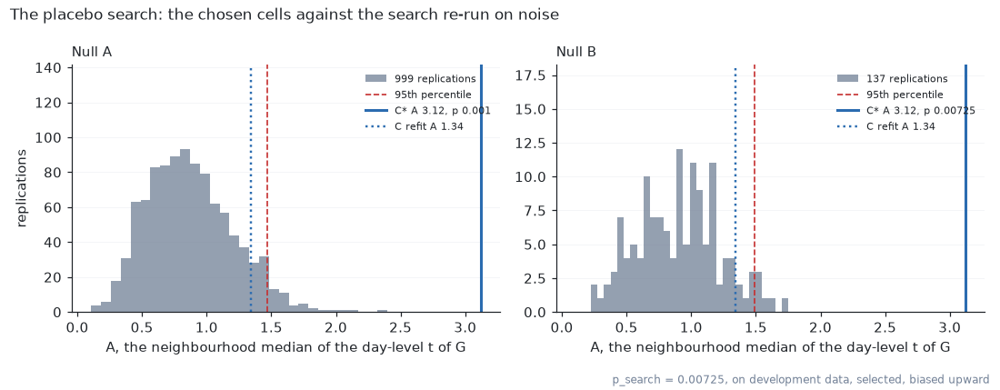
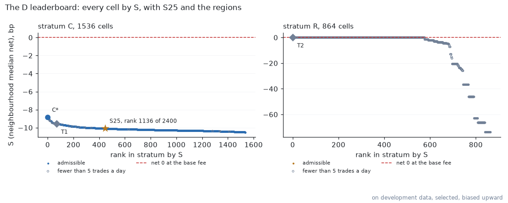
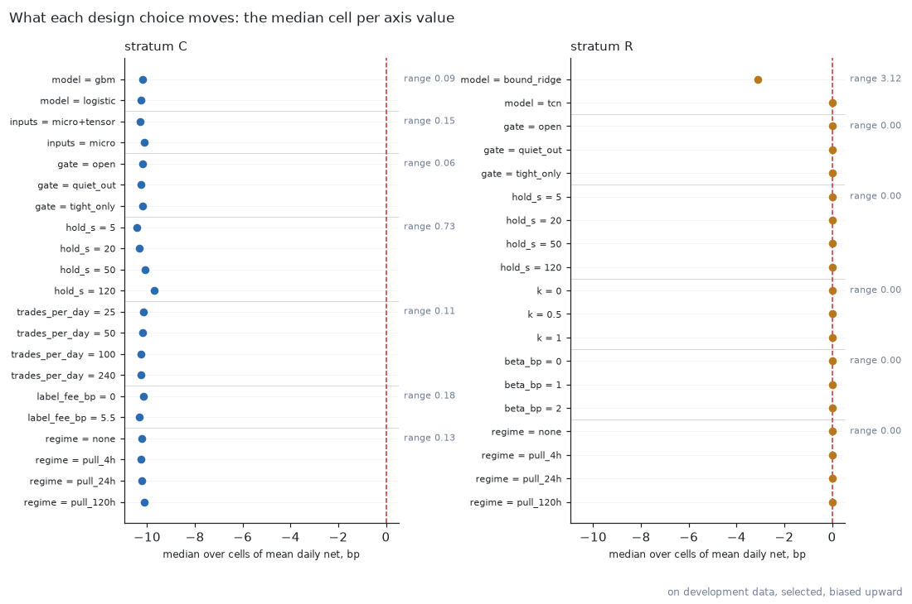
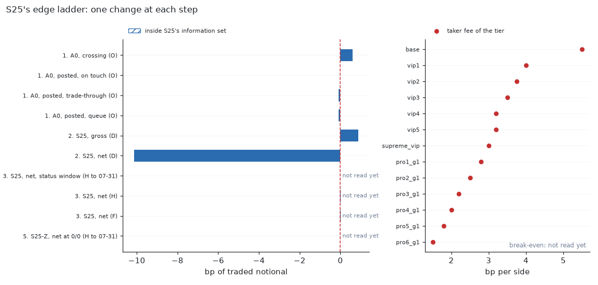
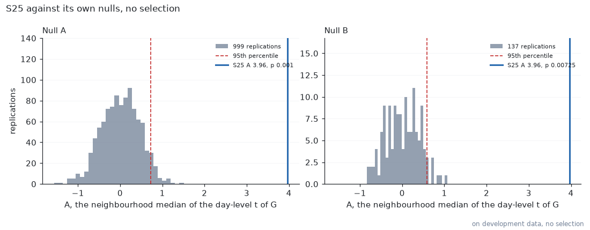
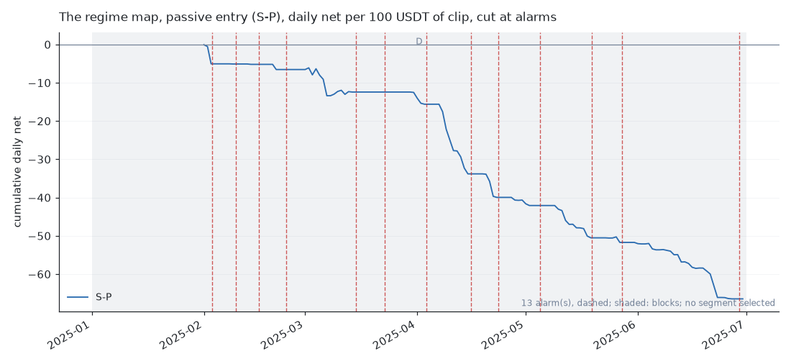
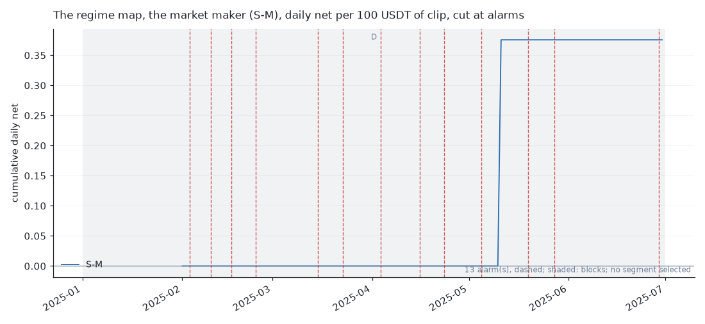
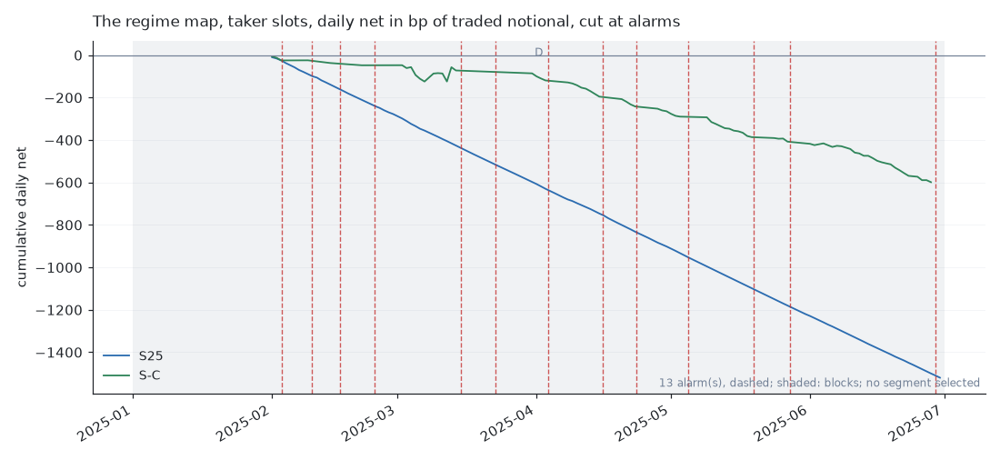
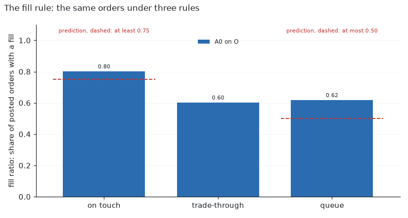

# The 2025 short-horizon search: its pages

Written by the entry point from the stages' records and the blocks' results; blocks read: none. Only H, F and P statuses and p_search are quoted as results; every D number is labelled on development data, selected.

## Headline sentences

- Searched 2,435 configurations (stratum, model, inputs, label fee, hold, decision threshold, market gate, regime policy) on 150 development days of BTCUSDT; on development data, selected, the best direction edge was distinguishable from search noise (p_search = 0.00725; Null A p = 0.001, Null B p = 0.00725; 1 D runs).
- No configuration paid the 5.5 bp taker fee on development data.
- Passive entry and the market maker on C*: S-P and S-M not admitted on D (hand run); the market maker's making part on D was -0.43 bp per fill.

Notes beside the sentences (their registered text is not edited):

- No admissible cell had a positive net (the highest admissible net was -5.09 bp per trade); the 24 cells with a positive net, all in stratum R and none admissible (fewer than 5 trades a day), had 16 at +73.6 to +83.2 bp on 3 trades, 2 at +42.2 bp on 6 trades, 6 at +11.0 bp on 7 trades over the 150 days (on development data, selected).
- S-M, not admitted on D (i, ii) on D's own conditions (i: making part −0.43 bp per fill; S = +0.0005): its S, net per 100 USDT of clip a day, was positive on D and its making part was not (on development data, selected).

### Pending

- S25: H is not read yet
- regime_axis: H is not read yet
- regime_map: no held-out block has a segment yet
- break: F is not read yet
- the break-detector view: no block read has kept its hourly close

## The placebo search

<picture>
  <source media="(prefers-color-scheme: dark)" srcset="../../docs/images/short_horizon_2025_placebo_search_dark.png">
  
</picture>

## The D leaderboard and marginals

<picture>
  <source media="(prefers-color-scheme: dark)" srcset="../../docs/images/short_horizon_2025_leaderboard_dark.png">
  
</picture>

<picture>
  <source media="(prefers-color-scheme: dark)" srcset="../../docs/images/short_horizon_2025_marginals_dark.png">
  
</picture>

## The finalists on H, then F and P

No block read yet.

## S25

S25 ranks 1136 of 2400 on the D leaderboard (on development data, selected, biased upward; S25 itself was fixed before D).

| step | row | block | value | unit | reference | label |
|---|---|---|---|---|---|---|
| 1 | A0, crossing | O | 0.60 | bp of traded notional |  | measurement |
| 1 | A0, posted, on touch | O | 0.00 | bp of traded notional |  | measurement |
| 1 | A0, posted, trade-through | O | -0.09 | bp of traded notional |  | measurement |
| 1 | A0, posted, queue | O | -0.09 | bp of traded notional |  | measurement |
| 2 | S25, gross | D | 0.87 | bp of traded notional |  | on development data, never quoted as a result |
| 2 | S25, net | D | -10.13 | bp of traded notional |  | on development data, never quoted as a result |
| 3 | S25, net, status window | H before 2025-08-01 |  | bp of traded notional |  | not read yet |
| 3 | S25, net | H |  | bp of traded notional |  | inside S25's information set; not read yet |
| 3 | S25, net | F |  | bp of traded notional |  | inside S25's information set; not read yet |
| 4 | S25, break-even per side, base | H before 2025-08-01 |  | bp per side | 5.50 | not read yet |
| 4 | S25, break-even per side, vip1 | H before 2025-08-01 |  | bp per side | 4.00 | not read yet |
| 4 | S25, break-even per side, vip2 | H before 2025-08-01 |  | bp per side | 3.75 | not read yet |
| 4 | S25, break-even per side, vip3 | H before 2025-08-01 |  | bp per side | 3.50 | not read yet |
| 4 | S25, break-even per side, vip4 | H before 2025-08-01 |  | bp per side | 3.20 | not read yet |
| 4 | S25, break-even per side, vip5 | H before 2025-08-01 |  | bp per side | 3.20 | not read yet |
| 4 | S25, break-even per side, supreme_vip | H before 2025-08-01 |  | bp per side | 3.00 | not read yet |
| 4 | S25, break-even per side, pro1_g1 | H before 2025-08-01 |  | bp per side | 2.80 | not read yet |
| 4 | S25, break-even per side, pro2_g1 | H before 2025-08-01 |  | bp per side | 2.50 | not read yet |
| 4 | S25, break-even per side, pro3_g1 | H before 2025-08-01 |  | bp per side | 2.20 | not read yet |
| 4 | S25, break-even per side, pro4_g1 | H before 2025-08-01 |  | bp per side | 2.00 | not read yet |
| 4 | S25, break-even per side, pro5_g1 | H before 2025-08-01 |  | bp per side | 1.80 | not read yet |
| 4 | S25, break-even per side, pro6_g1 | H before 2025-08-01 |  | bp per side | 1.50 | not read yet |
| 5 | S25-Z, net at 0/0 | H before 2025-08-01 |  | bp of traded notional |  | conditional on a zero-fee venue; not read yet |
| 5 | fill ratio, on touch | O | 0.80 | share of posted orders |  | beside |
| 5 | fill ratio, trade-through | O | 0.60 | share of posted orders |  | beside |
| 5 | fill ratio, queue | O | 0.62 | share of posted orders |  | beside |

Step 4, every tier other than the base: Bybit's linear-perpetual schedule as published in 2026 (page last updated 2026-09-02, transcribed 2026-10-02), applied to data from 2025-07-08 to 2025-07-31, when the schedule may have differed. Volumes are 30-day derivatives volume in USDT; Pro levels require more than 20% of volume through the API.

The leaderboard regions, measurements with no slot (on development data):

| region | cells | key | S | A | admissible | rank_in_stratum | rank_overall |
|---|---|---|---|---|---|---|---|
| T1 | 16 | BTCUSDT\|C\|gbm\|micro\|open\|hold_s=120\|trades_per_day=25\|label_fee_bp=5.5\|regime=none | -9.58 | 2.85 | True | 71 | 759 |
| T2 | 36 | BTCUSDT\|R\|tcn\|tensor+micro\|open\|hold_s=120\|k=0\|beta_bp=1\|regime=none | 0.00 | 0.00 | False | 1 | 1 |

<picture>
  <source media="(prefers-color-scheme: dark)" srcset="../../docs/images/short_horizon_2025_edge_ladder_dark.png">
  
</picture>

<picture>
  <source media="(prefers-color-scheme: dark)" srcset="../../docs/images/short_horizon_2025_placebo_s25_dark.png">
  
</picture>

## The regime map

<picture>
  <source media="(prefers-color-scheme: dark)" srcset="../../docs/images/short_horizon_2025_regime_map_entry_dark.png">
  
</picture>

<picture>
  <source media="(prefers-color-scheme: dark)" srcset="../../docs/images/short_horizon_2025_regime_map_maker_dark.png">
  
</picture>

<picture>
  <source media="(prefers-color-scheme: dark)" srcset="../../docs/images/short_horizon_2025_regime_map_taker_dark.png">
  
</picture>

## The break detector

Drawn once H is read.

## The fill rule

<picture>
  <source media="(prefers-color-scheme: dark)" srcset="../../docs/images/short_horizon_2025_fill_rules_dark.png">
  
</picture>

## Rows for docs/findings.md

### The 2025 short-horizon search on BTCUSDT

**Status: pre-registered, no block read** (blocks read: none). Every status is computed by the entry point and quoted from `experiments/results/short_horizon_2025_pages.md`; a D number is never one.

- none yet

On development data, beside the statuses set there:

- No admissible cell had a positive net (the highest admissible net was -5.09 bp per trade); the 24 cells with a positive net, all in stratum R and none admissible (fewer than 5 trades a day), had 16 at +73.6 to +83.2 bp on 3 trades, 2 at +42.2 bp on 6 trades, 6 at +11.0 bp on 7 trades over the 150 days (on development data, selected).
- S-M, not admitted on D (i, ii) on D's own conditions (i: making part −0.43 bp per fill; S = +0.0005): its S, net per 100 USDT of clip a day, was positive on D and its making part was not (on development data, selected).

## The README summary

Searched 2,435 configurations (stratum, model, inputs, label fee, hold, decision threshold, market gate, regime policy) on 150 development days of BTCUSDT; on development data, selected, the best direction edge was distinguishable from search noise (p_search = 0.00725; Null A p = 0.001, Null B p = 0.00725; 1 D runs). No configuration paid the 5.5 bp taker fee on development data. Passive entry and the market maker on C*: S-P and S-M not admitted on D (hand run); the market maker's making part on D was -0.43 bp per fill. Notes beside them: No admissible cell had a positive net (the highest admissible net was -5.09 bp per trade); the 24 cells with a positive net, all in stratum R and none admissible (fewer than 5 trades a day), had 16 at +73.6 to +83.2 bp on 3 trades, 2 at +42.2 bp on 6 trades, 6 at +11.0 bp on 7 trades over the 150 days (on development data, selected). S-M, not admitted on D (i, ii) on D's own conditions (i: making part −0.43 bp per fill; S = +0.0005): its S, net per 100 USDT of clip a day, was positive on D and its making part was not (on development data, selected).

<picture>
  <source media="(prefers-color-scheme: dark)" srcset="docs/images/short_horizon_2025_placebo_search_dark.png">
  
</picture>

<picture>
  <source media="(prefers-color-scheme: dark)" srcset="docs/images/short_horizon_2025_placebo_s25_dark.png">
  
</picture>

<picture>
  <source media="(prefers-color-scheme: dark)" srcset="docs/images/short_horizon_2025_leaderboard_dark.png">
  
</picture>

<picture>
  <source media="(prefers-color-scheme: dark)" srcset="docs/images/short_horizon_2025_marginals_dark.png">
  
</picture>

<picture>
  <source media="(prefers-color-scheme: dark)" srcset="docs/images/short_horizon_2025_edge_ladder_dark.png">
  
</picture>

<picture>
  <source media="(prefers-color-scheme: dark)" srcset="docs/images/short_horizon_2025_fill_rules_dark.png">
  
</picture>

<picture>
  <source media="(prefers-color-scheme: dark)" srcset="docs/images/short_horizon_2025_regime_map_taker_dark.png">
  
</picture>

<picture>
  <source media="(prefers-color-scheme: dark)" srcset="docs/images/short_horizon_2025_regime_map_entry_dark.png">
  
</picture>

<picture>
  <source media="(prefers-color-scheme: dark)" srcset="docs/images/short_horizon_2025_regime_map_maker_dark.png">
  
</picture>
