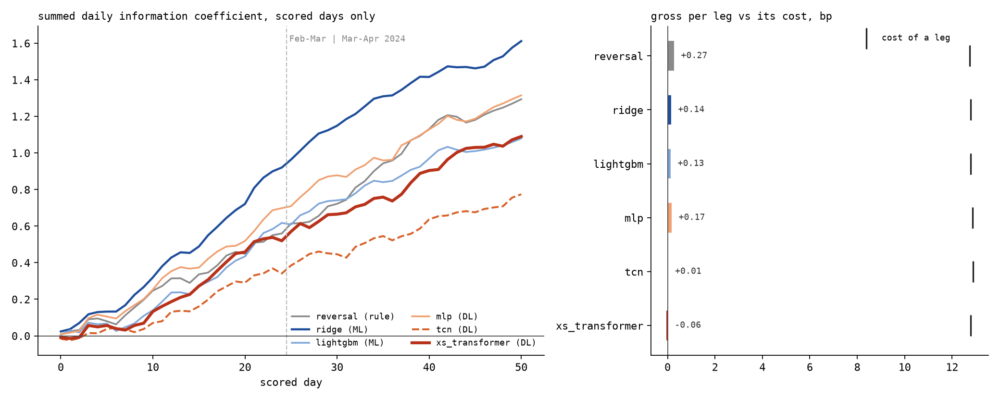

# Machine learning and deep learning on the cross-section, replayed on 2024

Written by `experiments/xs_deep_dev.py` (`report`). The six rankers of
[the registration](../../../docs/preregistration/xs_deep_forward_2026_12.md), at its settings,
fitted on 14 days and scored on the next 7, walking forward through 1 February to 10 March and
12 March to 20 April 2024. Every ten minutes each goes long its top 3 and short its bottom
3 of the 26 perpetuals for ten minutes, entering one minute after the decision, at Bybit's
base taker fee (5.5 bp a side) and the recorded spread. **A measurement on development
data, not the study's result**, which is read once on 30 November to 13 December 2026.

| ranker | kind | mean daily IC | *t* | days IC > 0 | gross / leg, bp | cost / leg, bp | net / leg, bp | net *t* | net at no fee, bp | legs |
|---|---|--:|--:|--:|--:|--:|--:|--:|--:|--:|
| `reversal` | rule | +0.0254 | +7.44 | 88% | +0.27 | 12.75 | -12.48 | -46.12 | -1.48 | 44,040 |
| `ridge` | ML | +0.0316 | +11.25 | 92% | +0.14 | 12.78 | -12.64 | -53.57 | -1.64 | 44,040 |
| `lightgbm` | ML | +0.0212 | +6.75 | 84% | +0.13 | 12.79 | -12.66 | -50.17 | -1.66 | 44,040 |
| `mlp` | DL | +0.0258 | +7.99 | 86% | +0.17 | 12.87 | -12.70 | -48.07 | -1.70 | 44,040 |
| `tcn` | DL | +0.0152 | +5.27 | 75% | +0.01 | 12.89 | -12.87 | -48.05 | -1.87 | 44,040 |
| `xs_transformer` | DL | +0.0214 | +6.41 | 82% | -0.06 | 12.79 | -12.85 | -46.00 | -1.85 | 44,040 |

*t* over the 51 scored days. IC: Spearman correlation across instruments of the
ranking and the next ten minutes' relative return.

- **Every ranker orders the instruments better than chance.** All six have a positive mean
  daily coefficient on both spans, on 75% to
  92% of days. The highest is `ridge`'s,
  +0.0316.
- **The networks do not beat the linear model.** `xs_transformer` minus `ridge`:
  -0.0102 a day (*t* -3.24).
  **Reading the other instruments helps a network:** `xs_transformer` minus `tcn`,
  +0.0062 (*t* +2.06).
  These are X2's and X3's quantities; their statuses are read on the test block only.
- **The order holds in ranks, not in basis points.** Half the relative return of the top three minus
  the bottom three, against the same for the top and bottom fifths, bp, February to March |
  March to April: `reversal` +0.02 vs +0.14 | +0.50 vs +0.44; `ridge` -0.02 vs -0.01 | +0.30 vs +0.31; `lightgbm` +0.08 vs +0.13 | +0.17 vs +0.24; `mlp` +0.04 vs +0.10 | +0.29 vs +0.27; `tcn` -0.35 vs -0.17 | +0.37 vs +0.34; `xs_transformer` -0.58 vs -0.24 | +0.45 vs +0.39.
  A coefficient of two or three hundredths across instruments whose ten-minute relative returns
  spread by about 25 to 35 bp is worth a fraction of a basis point at the ends. In February to
  March the three legs at each end earned less than the fifths, and the networks' lost: the
  largest moves, where the legs sit, are the ones that did not reverse.
- **Cost.** A leg pays about 12.8 bp in fee and spread. The largest gross per leg is `reversal`'s, +0.27 bp; no ranker's gross clears its cost. The cost is about fifty times the best gross.
- **By span.** Mean daily IC, February to March | March to April:
  `reversal` +0.022 | +0.028; `ridge` +0.037 | +0.027; `lightgbm` +0.025 | +0.018; `mlp` +0.028 | +0.024; `tcn` +0.014 | +0.017; `xs_transformer` +0.021 | +0.022.

Rank correlation of the rankers' scores, mean over decision times:

| | `reversal` | `ridge` | `lightgbm` | `mlp` | `tcn` | `xs_transformer` |
|---|--:|--:|--:|--:|--:|--:|
| `reversal` | +1.00 | +0.46 | +0.35 | +0.41 | +0.17 | +0.26 |
| `ridge` | +0.46 | +1.00 | +0.49 | +0.61 | +0.26 | +0.38 |
| `lightgbm` | +0.35 | +0.49 | +1.00 | +0.52 | +0.19 | +0.26 |
| `mlp` | +0.41 | +0.61 | +0.52 | +1.00 | +0.25 | +0.33 |
| `tcn` | +0.17 | +0.26 | +0.19 | +0.25 | +1.00 | +0.50 |
| `xs_transformer` | +0.26 | +0.38 | +0.26 | +0.33 | +0.50 | +1.00 |
