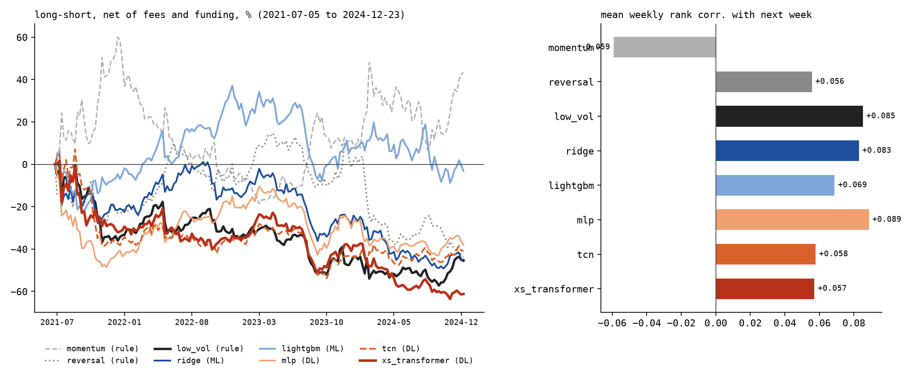

# ML and DL ranking a hundred perpetuals a week: 2021-07-05 to 2024-12-23

Written by `experiments/xs_weekly_report.py` from `development.json`
([registration](../../../docs/preregistration/xs_weekly_2026_11.md)). Every Monday each ranker
goes long its ten highest-ranked and short its ten lowest of the hundred most traded Binance
USDT perpetuals (about 100 on average), half the account a side, at taker fees
with funding. **A measurement on development weeks**; no status.

| ranker | kind | total % | a year % | Sharpe | worst drawdown % | price % | funding % | cost % | rank corr. | turnover | weekly *t* |
|---|---|--:|--:|--:|--:|--:|--:|--:|--:|--:|--:|
| `momentum` | rule | +43.3 | +10.8 | 0.48 | -49.2 | +34.9 | +30.4 | -12.4 | -0.059 | 98% | +0.90 |
| `reversal` | rule | -43.7 | -15.1 | -0.45 | -50.9 | +0.1 | -22.0 | -22.0 | +0.056 | 173% | -0.85 |
| `low_vol` | rule | -45.5 | -15.9 | -0.42 | -57.2 | -3.7 | -31.7 | -8.9 | +0.085 | 70% | -0.78 |
| `ridge` | ML | -44.9 | -15.7 | -0.54 | -49.8 | +10.8 | -40.0 | -18.9 | +0.083 | 148% | -1.01 |
| `lightgbm` | ML | -3.2 | -0.9 | 0.09 | -33.5 | +56.8 | -31.1 | -17.8 | +0.069 | 140% | +0.17 |
| `mlp` | DL | -38.1 | -12.8 | -0.40 | -48.5 | +20.2 | -37.7 | -18.3 | +0.089 | 143% | -0.74 |
| `tcn` | DL | -40.7 | -13.9 | -0.44 | -56.9 | +17.6 | -37.5 | -20.3 | +0.058 | 159% | -0.82 |
| `xs_transformer` | DL | -61.2 | -23.7 | -0.81 | -64.1 | -31.3 | -28.5 | -20.2 | +0.057 | 159% | -1.52 |

182 weeks. Price, funding and cost are summed weekly contributions to the account.

| model | weekly net minus `low_vol`'s, % | *t* |
|---|--:|--:|
| `ridge` | -0.020 | -0.08 |
| `lightgbm` | +0.287 | +0.96 |
| `mlp` | +0.047 | +0.18 |
| `tcn` | +0.023 | +0.08 |
| `xs_transformer` | -0.197 | -0.68 |

- **Highest total: `momentum`**, +43.3%.
