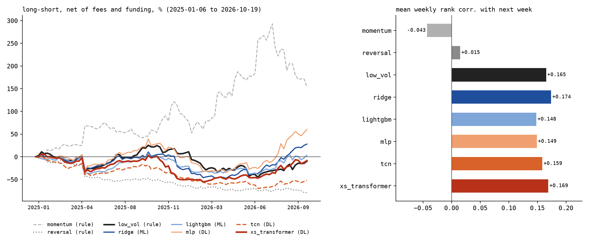

# ML and DL ranking a hundred perpetuals a week: 2025-01-06 to 2026-10-19

Written by `experiments/xs_weekly_report.py` from `result.json`
([registration](../../../docs/preregistration/xs_weekly_2026_11.md)). Every Monday each ranker
goes long its ten highest-ranked and short its ten lowest of the hundred most traded Binance
USDT perpetuals (about 100 on average), half the account a side, at taker fees
with funding. **Held-out weeks, read once.**

| model | W1, pays | Holm *p* | W2, beats `low_vol` | Holm *p* |
|---|---|--:|---|--:|
| `ridge` | **killed** | 0.931 | **killed** | 0.997 |
| `lightgbm` | **killed** | 1.000 | **killed** | 1.000 |
| `mlp` | **killed** | 0.745 | **killed** | 0.593 |
| `tcn` | **killed** | 1.000 | **killed** | 1.000 |
| `xs_transformer` | **killed** | 1.000 | **killed** | 1.000 |

| ranker | kind | total % | a year % | Sharpe | worst drawdown % | price % | funding % | cost % | rank corr. | turnover | weekly *t* |
|---|---|--:|--:|--:|--:|--:|--:|--:|--:|--:|--:|
| `momentum` | rule | +154.2 | +67.5 | 1.21 | -35.3 | +55.3 | +68.9 | -6.4 | -0.043 | 97% | +1.62 |
| `reversal` | rule | -78.8 | -57.6 | -1.44 | -78.9 | -92.6 | -26.3 | -11.0 | +0.015 | 167% | -1.94 |
| `low_vol` | rule | -9.8 | -5.6 | 0.15 | -56.2 | +89.6 | -72.2 | -4.0 | +0.165 | 61% | +0.20 |
| `ridge` | ML | +27.9 | +14.6 | 0.54 | -52.4 | +170.2 | -116.1 | -8.0 | +0.174 | 121% | +0.73 |
| `lightgbm` | ML | +3.3 | +1.8 | 0.30 | -43.2 | +132.4 | -97.4 | -8.6 | +0.148 | 130% | +0.41 |
| `mlp` | DL | +60.1 | +29.7 | 0.78 | -53.2 | +195.2 | -114.0 | -9.0 | +0.149 | 136% | +1.05 |
| `tcn` | DL | -52.4 | -33.7 | -0.64 | -70.3 | +93.5 | -137.5 | -9.5 | +0.159 | 145% | -0.87 |
| `xs_transformer` | DL | -8.6 | -4.8 | 0.15 | -57.9 | +163.1 | -140.6 | -9.5 | +0.169 | 144% | +0.20 |

94 weeks. Price, funding and cost are summed weekly contributions to the account.

| model | weekly net minus `low_vol`'s, % | *t* |
|---|--:|--:|
| `ridge` | +0.349 | +0.68 |
| `lightgbm` | +0.138 | +0.26 |
| `mlp` | +0.626 | +1.19 |
| `tcn` | -0.712 | -1.17 |
| `xs_transformer` | -0.004 | -0.01 |

- **Highest total: `momentum`**, +154.2%.
