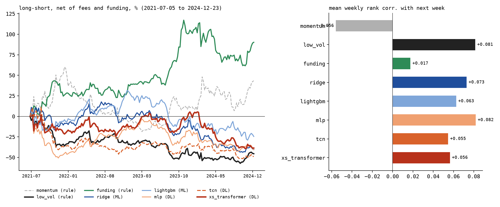

# ML and DL ranking a hundred perpetuals a week: 2021-07-05 to 2024-12-23

Written by `experiments/xs_weekly_report.py` from `development.json`
([registration](../../../docs/preregistration/xs_weekly_net_2026_11.md)). Every Monday each ranker
goes long its ten highest-ranked and short its ten lowest of the hundred most traded Binance
USDT perpetuals (about 100 on average), half the account a side, at taker fees
with funding. **A measurement on development weeks**; no status.

| ranker | kind | total % | a year % | Sharpe | worst drawdown % | price % | funding % | cost % | rank corr. | turnover | weekly *t* |
|---|---|--:|--:|--:|--:|--:|--:|--:|--:|--:|--:|
| `momentum` | rule | +43.3 | +10.8 | 0.48 | -49.2 | +34.9 | +30.4 | -12.4 | -0.056 | 98% | +0.90 |
| `low_vol` | rule | -45.5 | -15.9 | -0.42 | -57.2 | -3.7 | -31.7 | -8.9 | +0.081 | 70% | -0.78 |
| `funding` | rule | +90.2 | +20.2 | 0.93 | -25.6 | +16.3 | +64.8 | -7.8 | +0.017 | 61% | +1.73 |
| `ridge` | ML | -40.3 | -13.7 | -0.45 | -52.2 | -1.9 | -19.0 | -19.3 | +0.073 | 151% | -0.85 |
| `lightgbm` | ML | -24.5 | -7.7 | -0.19 | -46.0 | +13.3 | -12.0 | -17.9 | +0.063 | 140% | -0.35 |
| `mlp` | DL | -40.7 | -13.9 | -0.41 | -51.2 | -3.6 | -17.2 | -18.2 | +0.082 | 142% | -0.77 |
| `tcn` | DL | -48.8 | -17.4 | -0.57 | -56.3 | -22.8 | -10.3 | -20.8 | +0.055 | 163% | -1.07 |
| `xs_transformer` | DL | -38.6 | -13.0 | -0.37 | -42.4 | -16.4 | +0.9 | -19.8 | +0.056 | 156% | -0.69 |

182 weeks. Price, funding and cost are summed weekly contributions to the account.

| model | weekly net minus `momentum`'s, % | *t* |
|---|--:|--:|
| `ridge` | -0.512 | -1.10 |
| `lightgbm` | -0.382 | -0.78 |
| `mlp` | -0.505 | -0.95 |
| `tcn` | -0.587 | -1.16 |
| `xs_transformer` | -0.484 | -0.89 |

- **Highest total: `funding`**, +90.2%.
