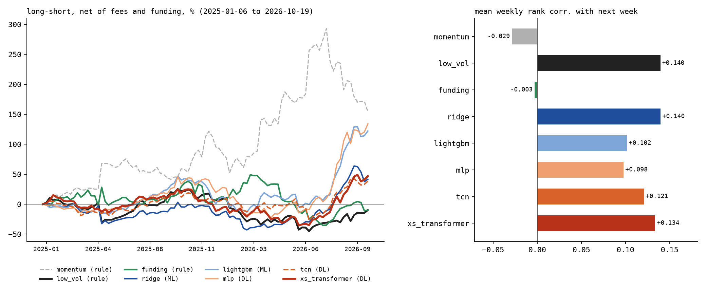

# ML and DL ranking a hundred perpetuals a week: 2025-01-06 to 2026-10-19

Written by `experiments/xs_weekly_report.py` from `result.json`
([registration](../../../docs/preregistration/xs_weekly_net_2026_11.md)). Every Monday each ranker
goes long its ten highest-ranked and short its ten lowest of the hundred most traded Binance
USDT perpetuals (about 100 on average), half the account a side, at taker fees
with funding. **Held-out weeks, read once.**

| model | N1, pays | Holm *p* | N2, beats `momentum` | Holm *p* |
|---|---|--:|---|--:|
| `ridge` | **killed** | 0.515 | **killed** | 1.000 |
| `lightgbm` | **killed** | 0.235 | **killed** | 1.000 |
| `mlp` | **killed** | 0.235 | **killed** | 1.000 |
| `tcn` | **killed** | 0.515 | **killed** | 1.000 |
| `xs_transformer` | **killed** | 0.515 | **killed** | 1.000 |

| ranker | kind | total % | a year % | Sharpe | worst drawdown % | price % | funding % | cost % | rank corr. | turnover | weekly *t* |
|---|---|--:|--:|--:|--:|--:|--:|--:|--:|--:|--:|
| `momentum` | rule | +154.2 | +67.5 | 1.21 | -35.3 | +55.3 | +68.9 | -6.4 | -0.029 | 97% | +1.62 |
| `low_vol` | rule | -9.8 | -5.6 | 0.15 | -56.2 | +89.6 | -72.2 | -4.0 | +0.140 | 61% | +0.20 |
| `funding` | rule | -9.9 | -5.6 | 0.17 | -56.5 | -134.7 | +155.0 | -3.9 | -0.003 | 59% | +0.22 |
| `ridge` | ML | +41.6 | +21.2 | 0.66 | -44.7 | +109.2 | -43.6 | -8.0 | +0.140 | 122% | +0.88 |
| `lightgbm` | ML | +122.0 | +55.4 | 1.26 | -40.9 | +113.5 | -8.5 | -9.1 | +0.102 | 138% | +1.69 |
| `mlp` | DL | +134.0 | +60.0 | 1.26 | -47.0 | +140.8 | -27.2 | -9.6 | +0.098 | 146% | +1.69 |
| `tcn` | DL | +38.3 | +19.7 | 0.66 | -41.7 | +70.2 | -13.6 | -10.0 | +0.121 | 151% | +0.89 |
| `xs_transformer` | DL | +46.7 | +23.6 | 0.71 | -48.2 | +76.7 | -11.9 | -9.8 | +0.134 | 149% | +0.95 |

94 weeks. Price, funding and cost are summed weekly contributions to the account.

| model | weekly net minus `momentum`'s, % | *t* |
|---|--:|--:|
| `ridge` | -0.642 | -0.55 |
| `lightgbm` | -0.234 | -0.23 |
| `mlp` | -0.147 | -0.14 |
| `tcn` | -0.757 | -0.72 |
| `xs_transformer` | -0.668 | -0.60 |

- **Highest total: `momentum`**, +154.2%.
