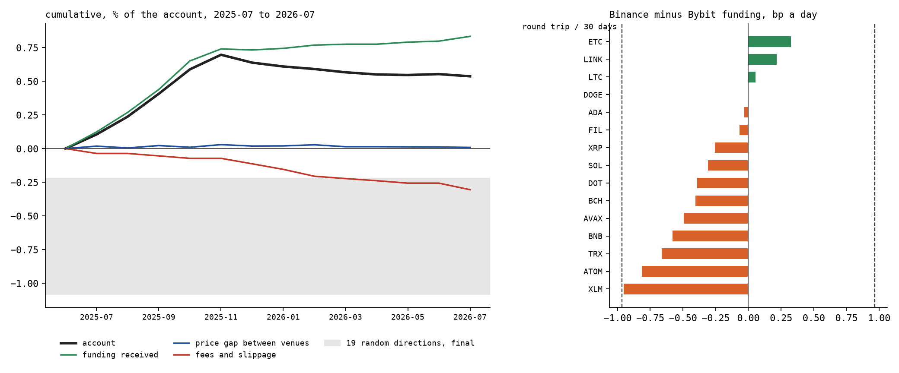

# The funding spread between Binance and Bybit: 2025-07 to 2026-07

Written by `experiments/xvenue_report.py` from `result.json`
([registration](../../../docs/preregistration/xvenue_funding_2026_11.md)). Each month the rule holds
up to four of fifteen coins' perpetuals on both venues, short where the last three months' funding
was higher and long where it was lower, at taker fees on both. **Held-out months, read once.**

| | status | |
|---|---|---|
| V1, the spread pays | **killed** | mean +0.041% a month, *t* +1.76, *p* 0.052 |
| V2, the direction matters | **passes** | beats 19 of 19 placebos |

| total % | a year % | Sharpe | worst drawdown % | losing months | mean a month % | *t* |
|--:|--:|--:|--:|--:|--:|--:|
| +0.50 | +0.46 | 1.69 | -0.16 | 7 of 13 | +0.041 | +1.76 |

- **Where it came from:** funding +0.83%, the price gap between the venues
  +0.01%, fees and slippage -0.31%; 1 month(s)
  with nothing held.
- **Bybit's funding is the higher one** on 12 of 15 coins on
  average, so the rule is mostly long on Binance and short on Bybit.
- **The direction matters:** the same coins with a random direction each month ended between
  -1.08% and -0.22%.
